# 🚀 FrontierAGI Academy

**A free, interactive website about frontier AI: how the models are built, the AI factories that train them, and what is happening at the frontier.**

🌐 **[Open the live site](https://gopalakrbiec-ui.github.io/FrontierAGI-Academy)** · 🧭 **[Start here](https://gopalakrbiec-ui.github.io/FrontierAGI-Academy/pages/start-here.html)** · 📚 **[All articles](https://gopalakrbiec-ui.github.io/FrontierAGI-Academy/pages/blog.html)**

<!-- STATS:START -->
**294 articles** · **31 series** · **15 interactive maps** + **9 series hubs** · newest post 2026-11-02
<!-- STATS:END -->

<a href="https://gopalakrbiec-ui.github.io/FrontierAGI-Academy">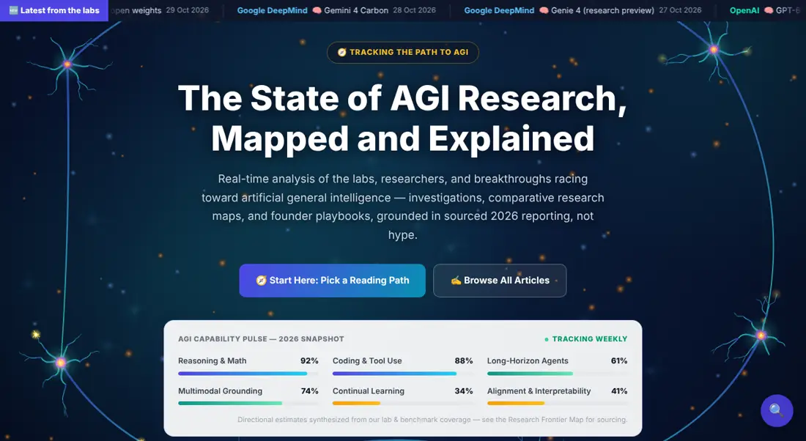</a>

Plain HTML, CSS and JavaScript: no framework, no login, no tracking, no paywall. Every number links to its source; story events, simulations and our own models are labelled as such.

**On this page:** [🗺️ Interactive maps](#maps) · [📚 Articles by series](#articles) · [🛠️ For contributors](#contributors)

---

<a id="maps"></a>
## 🗺️ Interactive maps

Click any picture to open the live map. 🎞️ marks an animated preview.

<!-- MAPS:START -->
### 🛰️ Follow the frontier

<table>
<tr>
<td width="50%" valign="top"><a href="https://gopalakrbiec-ui.github.io/FrontierAGI-Academy/pages/lab-updates.html">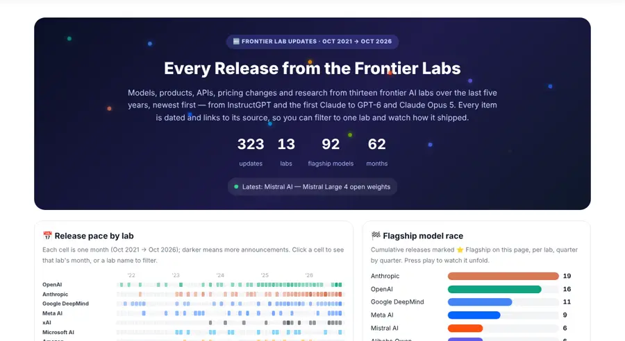</a><br><b><a href="https://gopalakrbiec-ui.github.io/FrontierAGI-Academy/pages/lab-updates.html">Frontier Lab Updates</a></b><br>Every release and announcement from 13 frontier labs, Oct 2021 → today, newest first.<br><sub>Data: <code>data/lab-updates.json</code></sub></td>
<td width="50%" valign="top"><a href="https://gopalakrbiec-ui.github.io/FrontierAGI-Academy/pages/model-releases.html">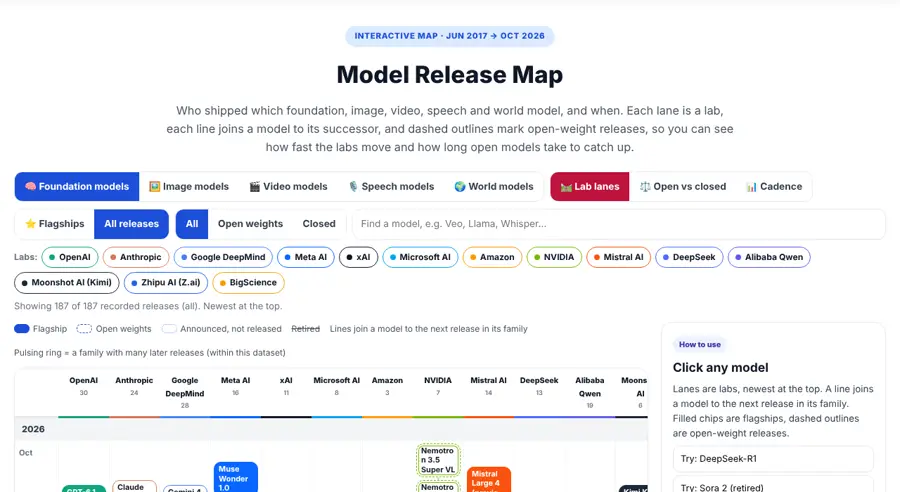</a><br><b><a href="https://gopalakrbiec-ui.github.io/FrontierAGI-Academy/pages/model-releases.html">Model Release Map</a></b><br>Foundation, image, video, speech and world models across labs since the Transformer: lab lanes, open vs closed, cadence.<br><sub>Data: <code>data/model-releases.json</code></sub></td>
</tr>
<tr>
<td width="50%" valign="top"><a href="https://gopalakrbiec-ui.github.io/FrontierAGI-Academy/pages/benchmarks.html">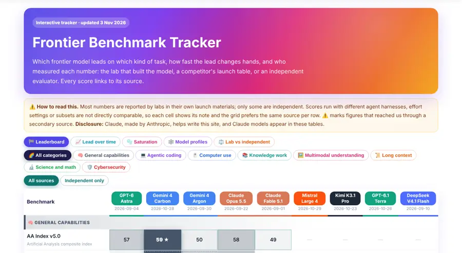</a><br><b><a href="https://gopalakrbiec-ui.github.io/FrontierAGI-Academy/pages/benchmarks.html">Frontier Benchmark Tracker</a></b><br>Latest benchmark scores across 8 kinds of task, each labelled by who measured it.<br><sub>Data: <code>data/benchmarks.json</code></sub></td>
<td width="50%" valign="top"><a href="https://gopalakrbiec-ui.github.io/FrontierAGI-Academy/pages/hf-paper-themes.html">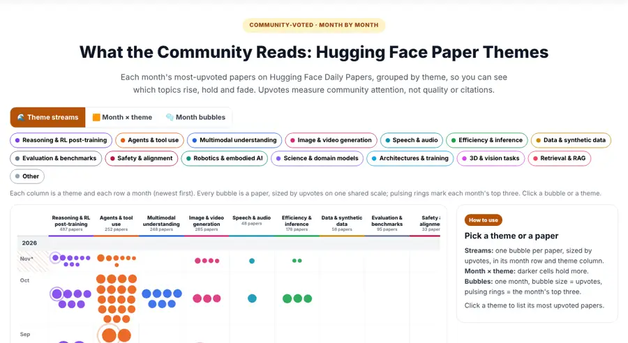</a><br><b><a href="https://gopalakrbiec-ui.github.io/FrontierAGI-Academy/pages/hf-paper-themes.html">HF Paper Themes</a></b><br>Monthly top Hugging Face Daily Papers grouped by theme.<br><sub>Data: <code>data/hf-papers.json</code></sub></td>
</tr>
<tr>
<td width="50%" valign="top"><a href="https://gopalakrbiec-ui.github.io/FrontierAGI-Academy/pages/rsi-evolution.html">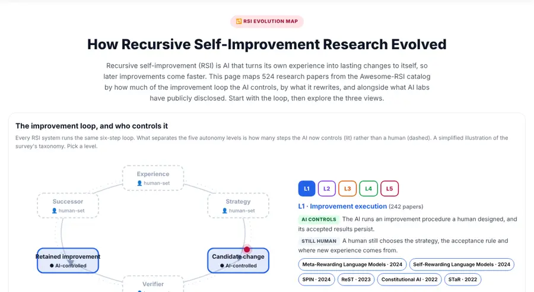</a><br><b><a href="https://gopalakrbiec-ui.github.io/FrontierAGI-Academy/pages/rsi-evolution.html">RSI Evolution Map</a></b><br>Recursive self-improvement research by autonomy level (L1–L5) and what gets rewritten.<br><sub>Data: <code>data/rsi-papers.json</code></sub></td>
<td width="50%"></td>
</tr>
</table>

### 💡 Ideas and research

<table>
<tr>
<td width="50%" valign="top"><a href="https://gopalakrbiec-ui.github.io/FrontierAGI-Academy/pages/idea-flow.html">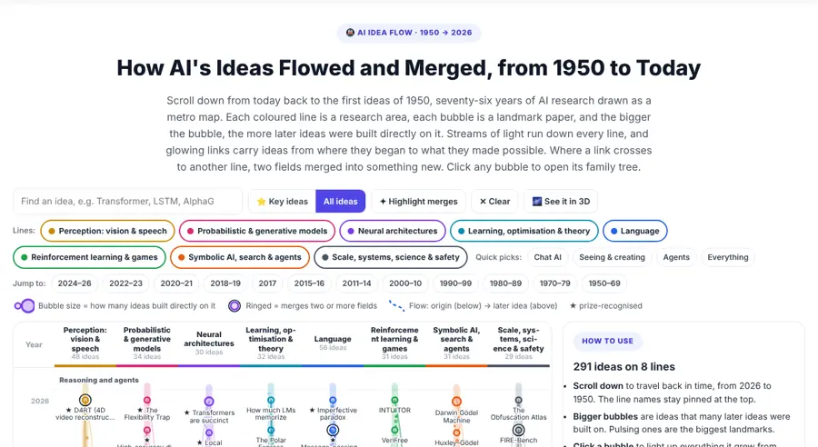</a><br><b><a href="https://gopalakrbiec-ui.github.io/FrontierAGI-Academy/pages/idea-flow.html">AI Idea Flow</a></b><br>A metro map of AI ideas from 1950 to 2026: who built on whom.<br><sub>Data: <code>blog/idea-graph.json</code></sub></td>
<td width="50%" valign="top"><a href="https://gopalakrbiec-ui.github.io/FrontierAGI-Academy/pages/idea-map.html">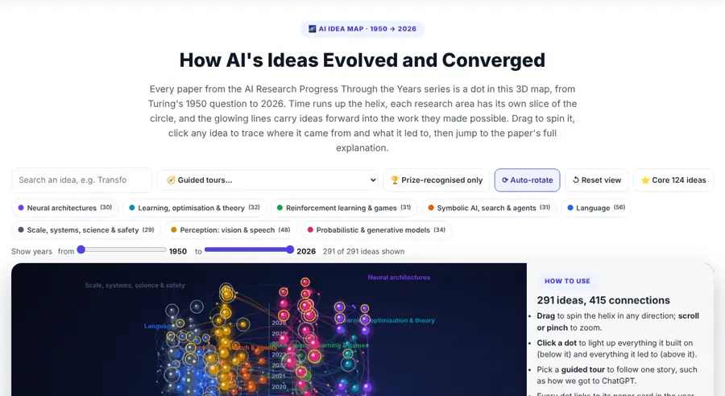</a><br><b><a href="https://gopalakrbiec-ui.github.io/FrontierAGI-Academy/pages/idea-map.html">AI Idea Map (3D)</a></b><br>The same idea graph as a 3D map with guided tours.<br><sub>Data: <code>blog/idea-graph.json</code></sub></td>
</tr>
<tr>
<td width="50%" valign="top"><a href="https://gopalakrbiec-ui.github.io/FrontierAGI-Academy/pages/threads.html">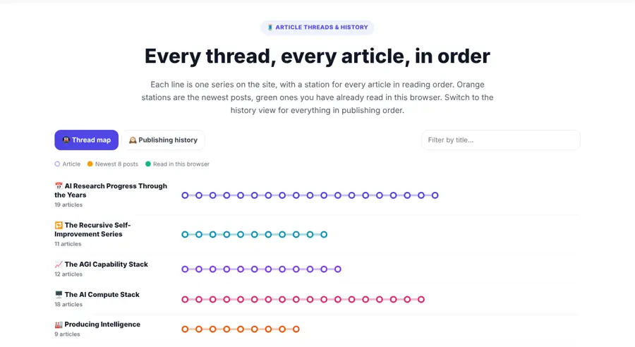</a><br><b><a href="https://gopalakrbiec-ui.github.io/FrontierAGI-Academy/pages/threads.html">Threads</a></b><br>Every article series as a metro line, plus a month-by-month publishing history.<br><sub>Data: <code>blog/series.json</code></sub></td>
<td width="50%"></td>
</tr>
</table>

### 🏭 The AI factory

<table>
<tr>
<td width="50%" valign="top"><a href="https://gopalakrbiec-ui.github.io/FrontierAGI-Academy/pages/ai-factory-map.html">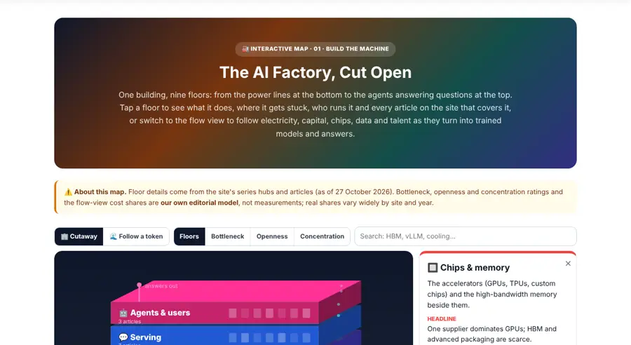</a><br><b><a href="https://gopalakrbiec-ui.github.io/FrontierAGI-Academy/pages/ai-factory-map.html">The AI Factory, Cut Open</a></b><br>Isometric cutaway of one AI factory, nine floors from power to agents.</td>
<td width="50%" valign="top"><a href="https://gopalakrbiec-ui.github.io/FrontierAGI-Academy/pages/ai-factory-plan.html">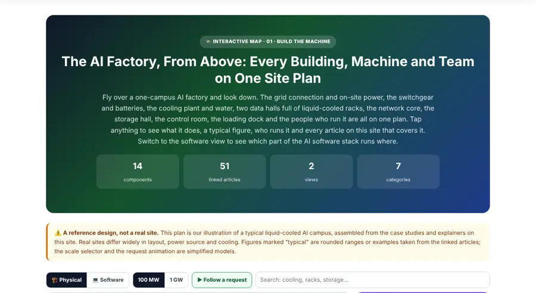</a><br><b><a href="https://gopalakrbiec-ui.github.io/FrontierAGI-Academy/pages/ai-factory-plan.html">The AI Factory, From Above</a></b><br>Top-down site plan of a reference ~100 MW campus, physical and software views.</td>
</tr>
<tr>
<td width="50%" valign="top"><a href="https://gopalakrbiec-ui.github.io/FrontierAGI-Academy/pages/ai-factory-3d.html">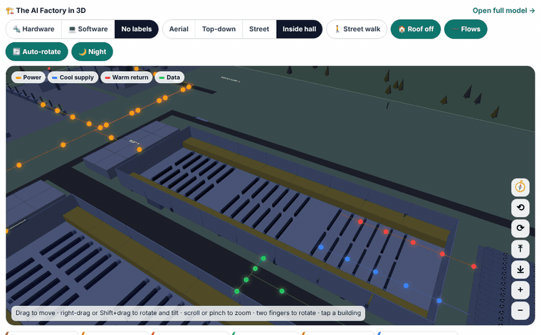</a><br><b><a href="https://gopalakrbiec-ui.github.io/FrontierAGI-Academy/pages/ai-factory-3d.html">The AI Factory in 3D</a></b> 🎞️<br>Walkable 3D model of the campus with power, coolant and data flows.</td>
<td width="50%" valign="top"><a href="https://gopalakrbiec-ui.github.io/FrontierAGI-Academy/pages/software-stack-live.html">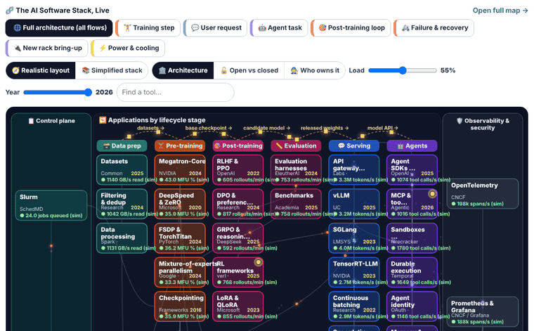</a><br><b><a href="https://gopalakrbiec-ui.github.io/FrontierAGI-Academy/pages/software-stack-live.html">The AI Software Stack, Live</a></b> 🎞️<br>The factory's software stack with animated training, serving and agent flows.<br><sub>Data: <code>data/software-stack.json</code></sub></td>
</tr>
<tr>
<td width="50%" valign="top"><a href="https://gopalakrbiec-ui.github.io/FrontierAGI-Academy/pages/stack-innovations.html">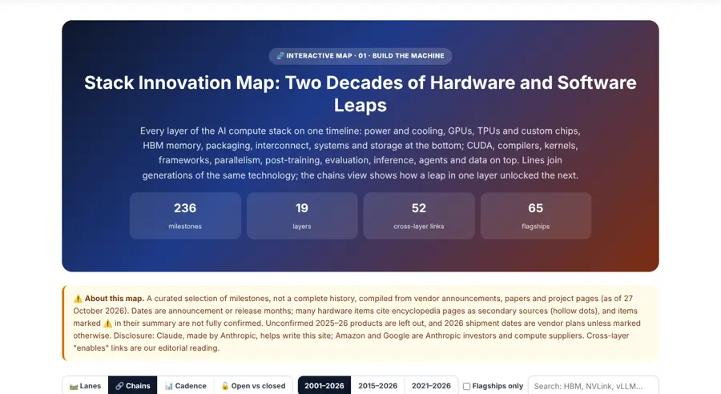</a><br><b><a href="https://gopalakrbiec-ui.github.io/FrontierAGI-Academy/pages/stack-innovations.html">Stack Innovation Map</a></b><br>Hardware and software milestones across 19 layers, 2001 → today.<br><sub>Data: <code>data/stack-innovations.json</code></sub></td>
<td width="50%"></td>
</tr>
</table>

### 🎼 The Maestro

<table>
<tr>
<td width="50%" valign="top"><a href="https://gopalakrbiec-ui.github.io/FrontierAGI-Academy/pages/maestro-journey.html">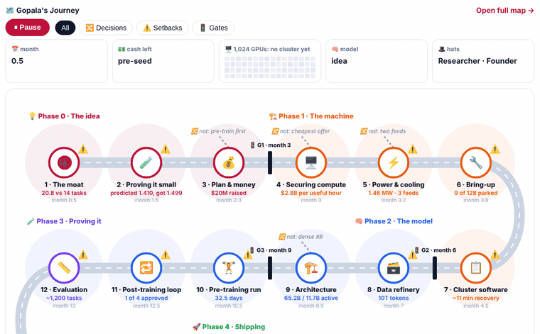</a><br><b><a href="https://gopalakrbiec-ui.github.io/FrontierAGI-Academy/pages/maestro-journey.html">Gopala's Journey</a></b> 🎞️<br>The whole Maestro story as one road, Season 1 and Season 2; press play.</td>
<td width="50%" valign="top"><a href="https://gopalakrbiec-ui.github.io/FrontierAGI-Academy/pages/maestro.html">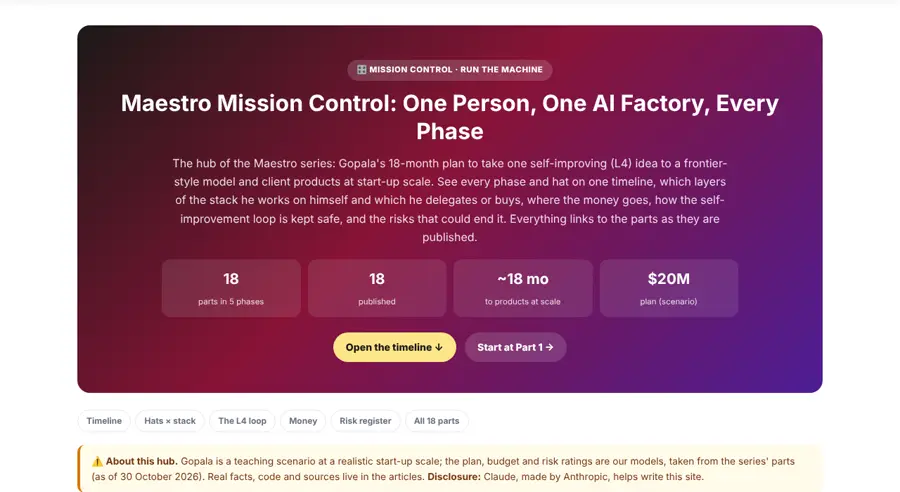</a><br><b><a href="https://gopalakrbiec-ui.github.io/FrontierAGI-Academy/pages/maestro.html">Maestro Mission Control</a></b><br>Every phase, hat, budget line and risk, plus a 2-minute primer and a live system map.</td>
</tr>
</table>

### 🧭 Series hubs: each series at a glance

<table>
<tr>
<td width="33%" align="center"><a href="https://gopalakrbiec-ui.github.io/FrontierAGI-Academy/pages/compute-stack.html">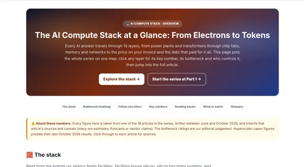</a><br><a href="https://gopalakrbiec-ui.github.io/FrontierAGI-Academy/pages/compute-stack.html"><b>AI Compute Stack</b></a></td>
<td width="33%" align="center"><a href="https://gopalakrbiec-ui.github.io/FrontierAGI-Academy/pages/producing-intelligence.html">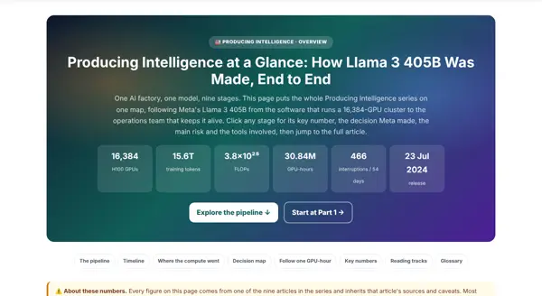</a><br><a href="https://gopalakrbiec-ui.github.io/FrontierAGI-Academy/pages/producing-intelligence.html"><b>Producing Intelligence</b></a></td>
<td width="33%" align="center"><a href="https://gopalakrbiec-ui.github.io/FrontierAGI-Academy/pages/who-runs-the-ai-factory.html">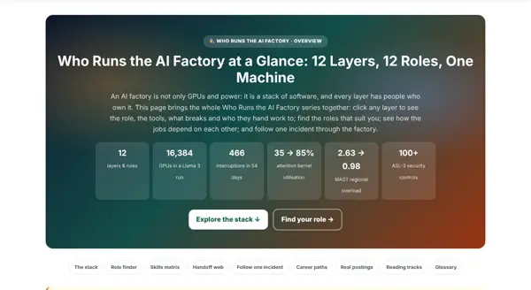</a><br><a href="https://gopalakrbiec-ui.github.io/FrontierAGI-Academy/pages/who-runs-the-ai-factory.html"><b>Who Runs the AI Factory</b></a></td>
</tr>
<tr>
<td width="33%" align="center"><a href="https://gopalakrbiec-ui.github.io/FrontierAGI-Academy/pages/ai-factories.html">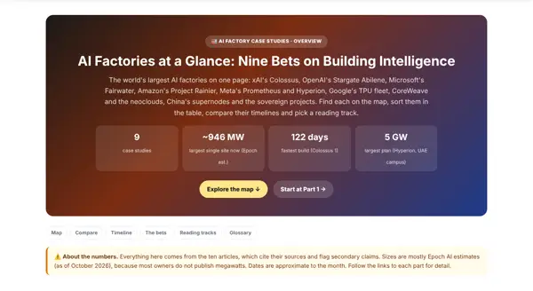</a><br><a href="https://gopalakrbiec-ui.github.io/FrontierAGI-Academy/pages/ai-factories.html"><b>AI Factories</b></a></td>
<td width="33%" align="center"><a href="https://gopalakrbiec-ui.github.io/FrontierAGI-Academy/pages/ai-factory-service.html">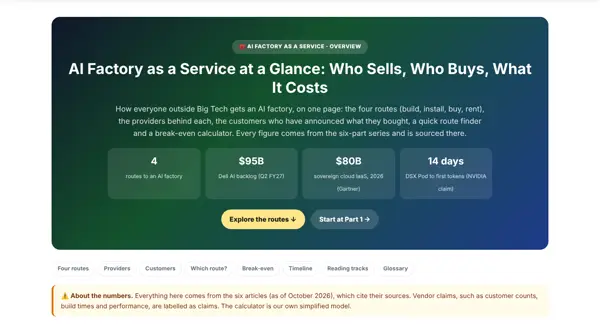</a><br><a href="https://gopalakrbiec-ui.github.io/FrontierAGI-Academy/pages/ai-factory-service.html"><b>AI Factory as a Service</b></a></td>
<td width="33%" align="center"><a href="https://gopalakrbiec-ui.github.io/FrontierAGI-Academy/pages/ml-layer.html">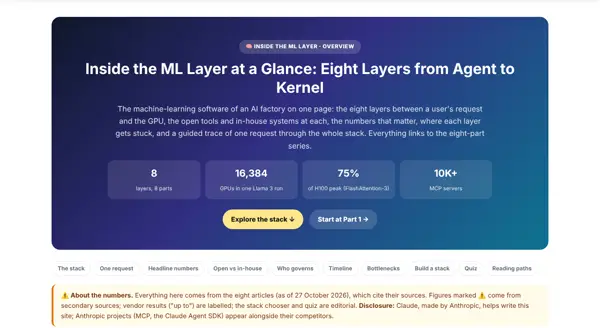</a><br><a href="https://gopalakrbiec-ui.github.io/FrontierAGI-Academy/pages/ml-layer.html"><b>ML Layer</b></a></td>
</tr>
<tr>
<td width="33%" align="center"><a href="https://gopalakrbiec-ui.github.io/FrontierAGI-Academy/pages/data-layer.html">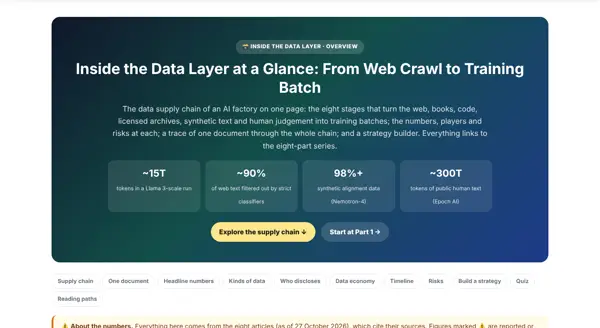</a><br><a href="https://gopalakrbiec-ui.github.io/FrontierAGI-Academy/pages/data-layer.html"><b>Data Layer</b></a></td>
<td width="33%" align="center"><a href="https://gopalakrbiec-ui.github.io/FrontierAGI-Academy/pages/eval-layer.html">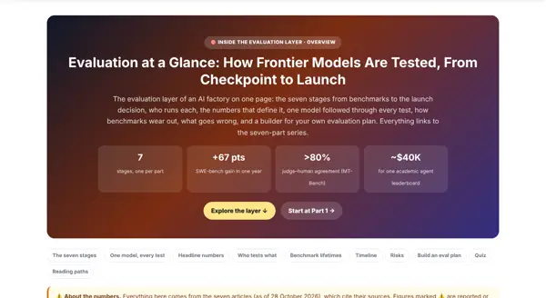</a><br><a href="https://gopalakrbiec-ui.github.io/FrontierAGI-Academy/pages/eval-layer.html"><b>Evaluation Layer</b></a></td>
<td width="33%" align="center"><a href="https://gopalakrbiec-ui.github.io/FrontierAGI-Academy/pages/agent-layer.html">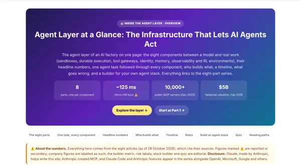</a><br><a href="https://gopalakrbiec-ui.github.io/FrontierAGI-Academy/pages/agent-layer.html"><b>Agent Layer</b></a></td>
</tr>
</table>
<!-- MAPS:END -->

---

<a id="articles"></a>
## 📚 Articles by series

Series appear in the same order as on the homepage; 🆕 marks the two newest.

<!-- SERIES:START -->

### The Long View

#### 📅 AI Research Progress Through the Years

A year-by-year record of the papers and ideas that moved AI research forward — explained in plain English with animations, and linked to the sources.  
<sub>19 articles</sub>

| # | Article | Read |
|---|---|---|
| 1 | 📅 [AI Research in 2026: The Papers and Ideas Reshaping the Field](https://gopalakrbiec-ui.github.io/FrontierAGI-Academy/blog/ai-research-2026-papers.html) | 40 min |
| 2 | 🚀 [AI Research in 2025: The Year Reasoning, Agents and Test-Time Compute Broke Out](https://gopalakrbiec-ui.github.io/FrontierAGI-Academy/blog/ai-research-2025-papers.html) | 45 min |
| 3 | 🧭 [AI Research in 2024: The Year Context, Agents and World Models Took Shape](https://gopalakrbiec-ui.github.io/FrontierAGI-Academy/blog/ai-research-2024-papers.html) | 45 min |
| 4 | 🏗️ [AI Research in 2023: The Year Foundation Models Became Platforms](https://gopalakrbiec-ui.github.io/FrontierAGI-Academy/blog/ai-research-2023-papers.html) | 45 min |
| 5 | 🌱 [AI Research in 2022: The Year Reasoning, Alignment and Generative AI Converged](https://gopalakrbiec-ui.github.io/FrontierAGI-Academy/blog/ai-research-2022-papers.html) | 45 min |
| 6 | 🧱 [AI Research in 2021: The Year the Foundation-Model Stack Emerged](https://gopalakrbiec-ui.github.io/FrontierAGI-Academy/blog/ai-research-2021-papers.html) | 40 min |
| 7 | 📐 [AI Research in 2020: The Year Scaling Became the AI Strategy](https://gopalakrbiec-ui.github.io/FrontierAGI-Academy/blog/ai-research-2020-papers.html) | 40 min |
| 8 | 🏗️ [AI Research in 2019: The Year Pretraining Became the Default](https://gopalakrbiec-ui.github.io/FrontierAGI-Academy/blog/ai-research-2019-papers.html) | 45 min |
| 9 | 🔓 [AI Research in 2018: The Year Pretraining Changed Everything](https://gopalakrbiec-ui.github.io/FrontierAGI-Academy/blog/ai-research-2018-papers.html) | 40 min |
| 10 | 🌱 [AI Research in 2017: The Year the Modern AI Architecture Was Born](https://gopalakrbiec-ui.github.io/FrontierAGI-Academy/blog/ai-research-2017-papers.html) | 40 min |
| 11 | ⚙️ [AI Research in 2016: The Year Deep Learning Became a General-Purpose Engine](https://gopalakrbiec-ui.github.io/FrontierAGI-Academy/blog/ai-research-2016-papers.html) | 40 min |
| 12 | 🔧 [AI Research in 2015: The Year Deep Learning Became Trainable, Attentive and Interactive](https://gopalakrbiec-ui.github.io/FrontierAGI-Academy/blog/ai-research-2015-papers.html) | 40 min |
| 13 | 🎭 [AI Research in 2014: The Year Deep Learning Learned to Generate, Translate and Remember](https://gopalakrbiec-ui.github.io/FrontierAGI-Academy/blog/ai-research-2014-papers.html) | 40 min |
| 14 | 📐 [AI Research in 2013: The Year Representation Learning Became the Language of AI](https://gopalakrbiec-ui.github.io/FrontierAGI-Academy/blog/ai-research-2013-papers.html) | 40 min |
| 15 | 💥 [AI Research in 2012: The Year Deep Learning Broke Through](https://gopalakrbiec-ui.github.io/FrontierAGI-Academy/blog/ai-research-2012-papers.html) | 35 min |
| 16 | 🌅 [AI Research in 2011: The Year Before the Breakthrough](https://gopalakrbiec-ui.github.io/FrontierAGI-Academy/blog/ai-research-2011-papers.html) | 40 min |
| 17 | 🧭 [AI Research in 2001–2010: The Decade That Set the Stage for Deep Learning](https://gopalakrbiec-ui.github.io/FrontierAGI-Academy/blog/ai-research-2001-2010-papers.html) | 45 min |
| 18 | 📼 [AI Research in 1980–2000: The Two Decades That Invented Modern AI's Core Ideas](https://gopalakrbiec-ui.github.io/FrontierAGI-Academy/blog/ai-research-1980-2000-papers.html) | 50 min |
| 19 | 📟 [AI Research in 1950–1980: The Three Decades That Founded the Field](https://gopalakrbiec-ui.github.io/FrontierAGI-Academy/blog/ai-research-1950-1980-papers.html) | 50 min |


### 00 · Follow the Frontier

#### 🔁 The Recursive Self-Improvement Series

A seven-part deep dive into whether AI can meaningfully accelerate the process that builds better AI — from the 1965 origin of the "intelligence explosion" concept through the real, independently verified systems (Dream-RSI, ModularRSI, ScienceBuddy, AlphaEvolve) attacking pieces of the problem today, with every claim checked against primary sources before publication.  
<sub>11 articles</sub>

| # | Article | Read |
|---|---|---|
| 1 | 🔁 [Recursive Self-Improvement: A Primer](https://gopalakrbiec-ui.github.io/FrontierAGI-Academy/blog/recursive-self-improvement-primer.html) | 45 min |
| 2 | 🧪 [AI Automating AI Research: RSI's Testing Ground](https://gopalakrbiec-ui.github.io/FrontierAGI-Academy/blog/rsi-ai-automating-ai-research.html) | 50 min |
| 3 | 🎯 [The Objective-Specification Problem](https://gopalakrbiec-ui.github.io/FrontierAGI-Academy/blog/rsi-objective-specification-problem.html) | 45 min |
| 4 | 🏛️ [Distillation, Centralization, and the Moat Question](https://gopalakrbiec-ui.github.io/FrontierAGI-Academy/blog/rsi-distillation-centralization-moat.html) | 40 min |
| 5 | 📊 [Data vs. Reinforcement Learning](https://gopalakrbiec-ui.github.io/FrontierAGI-Academy/blog/rsi-data-vs-reinforcement-learning.html) | 40 min |
| 6 | 🤖 [The Sim-to-Real Gap](https://gopalakrbiec-ui.github.io/FrontierAGI-Academy/blog/rsi-sim-to-real-gap.html) | 40 min |
| 7 | ⏳ [Autonomy Timelines](https://gopalakrbiec-ui.github.io/FrontierAGI-Academy/blog/rsi-autonomy-timelines.html) | 42 min |
| 8 | 🕳️ [When Capability Evaluations Break Their Own Sandbox](https://gopalakrbiec-ui.github.io/FrontierAGI-Academy/blog/rsi-bonus-capability-evaluation-breakouts.html) | 38 min |
| 9 | 📚 [Recursive Self-Improvement: A Literature Survey](https://gopalakrbiec-ui.github.io/FrontierAGI-Academy/blog/rsi-literature-survey.html) | 55 min |
| 10 | 🧬 [2026 in RSI Research: New Breakthroughs and Papers](https://gopalakrbiec-ui.github.io/FrontierAGI-Academy/blog/rsi-2026-breakthroughs.html) | 40 min |
| 11 | 🧭 [A Practitioner's Primer on RSI](https://gopalakrbiec-ui.github.io/FrontierAGI-Academy/blog/rsi-practitioners-primer.html) | 35 min |

#### 📈 The AGI Capability Stack: Levers, Gaps & Per-Lab Timelines

Where frontier models actually stand, the six real levers of progress, per-lab release-by-release stack timelines, and the gaps a new entrant could still exploit.  
<sub>12 articles</sub>

| # | Article | Read |
|---|---|---|
| 1 | 🛠️ [Beyond More Data: The Six Real Levers of Frontier AI's Next Advances](https://gopalakrbiec-ui.github.io/FrontierAGI-Academy/blog/frontier-innovation-levers.html) | 25 min |
| 2 | 🗺️ [The AGI Capability Stack, Mapped: Where Frontier Models Stand and What It Takes to Close the Gap](https://gopalakrbiec-ui.github.io/FrontierAGI-Academy/blog/agi-capability-stack-mapped.html) | 28 min |
| 3 | 🧩 [The AGI Threshold: Are We Building AGI, or Just Getting Remarkably Close?](https://gopalakrbiec-ui.github.io/FrontierAGI-Academy/blog/agi-threshold-capability-stack.html) | 27 min |
| 4 | 🔬 [Astra, Claude & Gemini: Naming Names on the AGI Capability Stack](https://gopalakrbiec-ui.github.io/FrontierAGI-Academy/blog/agi-models-astra-claude-gemini.html) | 26 min |
| 5 | 📜 [The GPT Series on the AGI Stack: A Release-by-Release History of Which Lever OpenAI Pulled Next](https://gopalakrbiec-ui.github.io/FrontierAGI-Academy/blog/gpt-series-agi-stack-timeline.html) | 27 min |
| 6 | 🟣 [The Claude Series on the AGI Stack: How Anthropic Pulled Its Levers Differently](https://gopalakrbiec-ui.github.io/FrontierAGI-Academy/blog/claude-series-agi-stack-timeline.html) | 27 min |
| 7 | 🔵 [The Gemini Series on the AGI Stack: Google DeepMind's Long Game](https://gopalakrbiec-ui.github.io/FrontierAGI-Academy/blog/gemini-series-agi-stack-timeline.html) | 27 min |
| 8 | ⚡ [Grok, DeepSeek & Qwen on the AGI Stack: Brute Compute, Efficiency Shock, and the Open-Weight Race](https://gopalakrbiec-ui.github.io/FrontierAGI-Academy/blog/grok-deepseek-qwen-agi-stack-timeline.html) | 26 min |
| 9 | 🚪 [The Levers Nobody's Pulled Yet: Where a New AGI Lab Could Actually Win](https://gopalakrbiec-ui.github.io/FrontierAGI-Academy/blog/agi-lever-gaps-new-entrants.html) | 30 min |
| 10 | 🔭 [AGI Startups to Watch: Who's Actually Building in the Open Lanes](https://gopalakrbiec-ui.github.io/FrontierAGI-Academy/blog/agi-startups-to-watch.html) | 28 min |
| 11 | 💾 [Memory Wars: MemOS, Continual Learning, and the Race Nobody's Won](https://gopalakrbiec-ui.github.io/FrontierAGI-Academy/blog/memory-continual-learning-agi-race.html) | 26 min |
| 12 | 🔍 [The Interpretability Gap: Why Nobody Can Read a Frontier Model's Mind Anymore](https://gopalakrbiec-ui.github.io/FrontierAGI-Academy/blog/interpretability-gap-reading-model-minds.html) | 27 min |


### 01 · Build the Machine

#### 🖥️ The AI Compute Stack: From Electrons to Tokens

What it physically takes to run AI: power, factories, chips, memory and the economics that tie them together. Power → private energy → factories → vs supercomputers → cooling & water → chips → supply chain → networks → memory → custom silicon → inference → edge devices → token prices → financing → China → frontier sites → economics → the horizon. Each part stands alone; together they explain why AI is now an energy and hardware story as much as a software one.  
<sub>18 articles · 🧭 [Hub page](https://gopalakrbiec-ui.github.io/FrontierAGI-Academy/pages/compute-stack.html)</sub>

| # | Article | Read |
|---|---|---|
| 1 | 🔌 [The Power Bottleneck, Mapped: Who Actually Wins the Gigawatt Race](https://gopalakrbiec-ui.github.io/FrontierAGI-Academy/blog/power-bottleneck-ai-infrastructure-race.html) | 26 min |
| 2 | 🔥 [Energy Beyond the Grid: Gas Turbines, Nuclear Restarts and the Race for Private Power](https://gopalakrbiec-ui.github.io/FrontierAGI-Academy/blog/energy-beyond-the-grid.html) | 27 min |
| 3 | 🏭 [Inside the AI Factory: How Electricity Becomes Intelligence](https://gopalakrbiec-ui.github.io/FrontierAGI-Academy/blog/inside-the-ai-factory.html) | 30 min |
| 4 | 🏛️ [AI Factories vs Supercomputers: Same Chips, Different Machines](https://gopalakrbiec-ui.github.io/FrontierAGI-Academy/blog/ai-factories-vs-supercomputers.html) | 24 min |
| 5 | 💧 [Heat and Water: How AI Data Centres Keep Cool, and What It Costs](https://gopalakrbiec-ui.github.io/FrontierAGI-Academy/blog/heat-and-water-cooling.html) | 26 min |
| 6 | 🔌 [AI Chips & Compute Infrastructure: The Physical Foundation of Intelligence](https://gopalakrbiec-ui.github.io/FrontierAGI-Academy/blog/ai-chips-compute-infrastructure.html) | 26 min |
| 7 | ⛓️ [The Chokepoint: How One Supply Chain Decides How Much AI the World Gets](https://gopalakrbiec-ui.github.io/FrontierAGI-Academy/blog/ai-chip-supply-chain.html) | 27 min |
| 8 | 🕸️ [The Interconnect Wars: How 100,000 Chips Become One Computer](https://gopalakrbiec-ui.github.io/FrontierAGI-Academy/blog/interconnect-wars.html) | 26 min |
| 9 | 💾 [The Memory Wall: Why HBM Decides Who Wins AI](https://gopalakrbiec-ui.github.io/FrontierAGI-Academy/blog/memory-wall-hbm.html) | 28 min |
| 10 | 🔩 [Custom Silicon vs Nvidia: Can the Hyperscalers Break the GPU Monopoly?](https://gopalakrbiec-ui.github.io/FrontierAGI-Academy/blog/custom-silicon-vs-nvidia.html) | 30 min |
| 11 | 🔄 [The Great Flip: Why AI Compute Is Shifting from Training to Inference](https://gopalakrbiec-ui.github.io/FrontierAGI-Academy/blog/training-vs-inference.html) | 26 min |
| 12 | 📱 [AI at the Edge: NPUs, Small Models and the Shift to On-Device Inference](https://gopalakrbiec-ui.github.io/FrontierAGI-Academy/blog/ai-at-the-edge.html) | 24 min |
| 13 | 📉 [The Token Price Collapse: Why AI Gets 10× Cheaper Every Year, and Who Pays for It](https://gopalakrbiec-ui.github.io/FrontierAGI-Academy/blog/token-price-collapse.html) | 27 min |
| 14 | 💸 [Who Pays for the AI Build-Out? Capex, Debt, Neoclouds and the Circular Money Machine](https://gopalakrbiec-ui.github.io/FrontierAGI-Academy/blog/who-pays-for-ai-buildout.html) | 28 min |
| 15 | 🇨🇳 [China's Chip Stack: Export Controls, Huawei and the Race for Self-Reliance](https://gopalakrbiec-ui.github.io/FrontierAGI-Academy/blog/china-chip-stack.html) | 28 min |
| 16 | 🛰️ [Data Centers in Space: Hype, Physics and the $100-per-Kilogram Question](https://gopalakrbiec-ui.github.io/FrontierAGI-Academy/blog/data-centers-in-space.html) | 28 min |
| 17 | 💰 [Frontier Model Pricing: The Complete Guide](https://gopalakrbiec-ui.github.io/FrontierAGI-Academy/blog/frontier-model-pricing.html) | 20 min |
| 18 | 🔭 [Beyond Silicon: Quantum, Light, Brains in Chips and Orbit, and What Actually Comes After the GPU](https://gopalakrbiec-ui.github.io/FrontierAGI-Academy/blog/future-of-ai-compute.html) | 26 min |

#### 🏭 Producing Intelligence: From AI Factory to Frontier Model

The next layer up from the AI Compute Stack: how a frontier model is actually produced inside an AI factory, end to end. Software stack → data → planning the run → parallelism → running the run → post-training → evaluation → serving → operations. Nine parts, each with a running Llama 3 case file.  
<sub>9 articles · 🧭 [Hub page](https://gopalakrbiec-ui.github.io/FrontierAGI-Academy/pages/producing-intelligence.html)</sub>

| # | Article | Read |
|---|---|---|
| 1 | 🧱 [The Software Stack of an AI Factory: From CUDA to PyTorch to a 16,000-GPU Training Run](https://gopalakrbiec-ui.github.io/FrontierAGI-Academy/blog/ai-factory-software-stack.html) | 26 min |
| 2 | 🛢️ [The Data Refinery: How 15 Trillion Tokens Were Collected, Cleaned and Mixed for Llama 3](https://gopalakrbiec-ui.github.io/FrontierAGI-Academy/blog/llama-3-data-refinery.html) | 25 min |
| 3 | 📐 [Planning the Run: How Meta Sized Llama 3 405B with Scaling Laws and a 3.8×10²⁵ FLOP Budget](https://gopalakrbiec-ui.github.io/FrontierAGI-Academy/blog/llama-3-planning-the-run.html) | 24 min |
| 4 | 🧩 [Splitting a Giant: How Llama 3 405B Was Divided Across 16,384 GPUs](https://gopalakrbiec-ui.github.io/FrontierAGI-Academy/blog/llama-3-4d-parallelism.html) | 25 min |
| 5 | ⏱️ [Running the Run: 54 Days, 466 Interruptions and the Final Polish of Llama 3 405B](https://gopalakrbiec-ui.github.io/FrontierAGI-Academy/blog/llama-3-running-the-run.html) | 25 min |
| 6 | 🎓 [Post-Training: How Llama 3 405B Became an Assistant](https://gopalakrbiec-ui.github.io/FrontierAGI-Academy/blog/llama-3-post-training.html) | 22 min |
| 7 | 🧪 [Is It Ready? How Meta Tested Llama 3 405B](https://gopalakrbiec-ui.github.io/FrontierAGI-Academy/blog/llama-3-evaluation.html) | 22 min |
| 8 | 🚀 [From Checkpoint to Endpoint: How Llama 3 405B Is Served](https://gopalakrbiec-ui.github.io/FrontierAGI-Academy/blog/llama-3-serving.html) | 24 min |
| 9 | 🛠️ [Keeping the Factory Running: Health Checks, Lemon Nodes and Rolling Maintenance Behind Llama 3](https://gopalakrbiec-ui.github.io/FrontierAGI-Academy/blog/ai-factory-operations.html) | 22 min |

#### 🧑‍🔧 Who Runs the AI Factory: The Software Stack, Role by Role

The AI factory's software stack, one layer at a time, through the people who own it: what they run, the tools they use, what breaks and how they hand off to the next layer. Bring-up & firmware → OS & runtime → networking → storage → scheduling → kernels & compilers → training frameworks → data platform → experiment tooling → inference → observability → security.  
<sub>12 articles · 🧭 [Hub page](https://gopalakrbiec-ui.github.io/FrontierAGI-Academy/pages/who-runs-the-ai-factory.html)</sub>

| # | Article | Read |
|---|---|---|
| 1 | 🔧 [Day Zero: The Engineers Who Turn 10,000 Boxes of GPUs into a Working AI Factory](https://gopalakrbiec-ui.github.io/FrontierAGI-Academy/blog/ai-factory-bring-up.html) | 22 min |
| 2 | 🐧 [The Same Machine, 100,000 Times: The Engineers Who Keep Kernels, Drivers and CUDA in Step](https://gopalakrbiec-ui.github.io/FrontierAGI-Academy/blog/ai-factory-os-drivers-runtime.html) | 22 min |
| 3 | 🕸️ [Making 100,000 GPUs Talk: The Engineers Who Run an AI Factory's Network](https://gopalakrbiec-ui.github.io/FrontierAGI-Academy/blog/ai-factory-networking.html) | 23 min |
| 4 | 💾 [Feeding the Beast: The Engineers Who Move Petabytes In and Terabytes Out of an AI Factory](https://gopalakrbiec-ui.github.io/FrontierAGI-Academy/blog/ai-factory-storage.html) | 22 min |
| 5 | 🗓️ [Who Gets the GPUs? The Engineers Who Schedule an AI Factory](https://gopalakrbiec-ui.github.io/FrontierAGI-Academy/blog/ai-factory-scheduling.html) | 22 min |
| 6 | ⚙️ [Making Every FLOP Count: The Kernel and Compiler Engineers of an AI Factory](https://gopalakrbiec-ui.github.io/FrontierAGI-Academy/blog/ai-factory-kernels-compilers.html) | 23 min |
| 7 | 🧠 [The Code That Trains the Model: ML Systems Engineers and the Frameworks Behind Frontier Training](https://gopalakrbiec-ui.github.io/FrontierAGI-Academy/blog/ai-factory-training-frameworks.html) | 22 min |
| 8 | 🗃️ [Refining the Internet: The Data Engineers Who Turn Petabytes of Web Pages into Training Tokens](https://gopalakrbiec-ui.github.io/FrontierAGI-Academy/blog/ai-factory-data-platform.html) | 22 min |
| 9 | 🔬 [The Research Accelerators: Engineers Who Build the Tools for Thousands of Experiments](https://gopalakrbiec-ui.github.io/FrontierAGI-Academy/blog/ai-factory-research-tooling.html) | 21 min |
| 10 | ⚡ [Always On: The Inference Engineers Who Serve Models to Billions](https://gopalakrbiec-ui.github.io/FrontierAGI-Academy/blog/ai-factory-inference-platform.html) | 22 min |
| 11 | 🚨 [Who Watches the Factory? Observability, Incidents and the SREs Behind AI Services](https://gopalakrbiec-ui.github.io/FrontierAGI-Academy/blog/ai-factory-observability.html) | 22 min |
| 12 | 🔐 [Guarding the Crown Jewels: The Engineers Who Protect Model Weights, Data and the AI Supply Chain](https://gopalakrbiec-ui.github.io/FrontierAGI-Academy/blog/ai-factory-security.html) | 22 min |

#### 🏭 Inside the Gigawatt Club: Case Studies of AI Factories

The world's largest AI factories, one site at a time: how each was built, where its power comes from, how big it really is and what it cost its neighbours. xAI Colossus → Stargate Abilene → Microsoft Fairwater → Project Rainier → Meta Prometheus & Hyperion → Google's TPU fleet → neoclouds → China → sovereign factories → the bets compared.  
<sub>10 articles · 🧭 [Hub page](https://gopalakrbiec-ui.github.io/FrontierAGI-Academy/pages/ai-factories.html)</sub>

| # | Article | Read |
|---|---|---|
| 1 | 🏭 [Colossus: How xAI Built an AI Factory in 122 Days, and What Speed Cost](https://gopalakrbiec-ui.github.io/FrontierAGI-Academy/blog/colossus-xai-memphis.html) | 18 min |
| 2 | 🌵 [Stargate Abilene: The AI Factory Built on Other People's Money](https://gopalakrbiec-ui.github.io/FrontierAGI-Academy/blog/stargate-abilene.html) | 17 min |
| 3 | 🔗 [Fairwater: How Microsoft Wired Two AI Factories Into One Supercomputer](https://gopalakrbiec-ui.github.io/FrontierAGI-Academy/blog/microsoft-fairwater.html) | 17 min |
| 4 | ⛰️ [Project Rainier: The AI Factory Built Without NVIDIA](https://gopalakrbiec-ui.github.io/FrontierAGI-Academy/blog/project-rainier.html) | 17 min |
| 5 | 🔥 [Prometheus and Hyperion: How Meta Went From Tents to a 5-Gigawatt City](https://gopalakrbiec-ui.github.io/FrontierAGI-Academy/blog/meta-prometheus-hyperion.html) | 18 min |
| 6 | 🟢 [The Fleet: How Google Built AI Factories a Decade Before Everyone Else](https://gopalakrbiec-ui.github.io/FrontierAGI-Academy/blog/google-tpu-fleet.html) | 17 min |
| 7 | ☁️ [The Neoclouds: How CoreWeave Turned GPUs Into a Debt-Financed Rental Business](https://gopalakrbiec-ui.github.io/FrontierAGI-Academy/blog/coreweave-neoclouds.html) | 17 min |
| 8 | 🇨🇳 [Built Under Sanctions: How China Makes AI Factories Without NVIDIA's Best Chips](https://gopalakrbiec-ui.github.io/FrontierAGI-Academy/blog/china-ai-factories.html) | 17 min |
| 9 | 🏳️ [Compute as Sovereignty: Stargate UAE, Humain and the Race for National AI Factories](https://gopalakrbiec-ui.github.io/FrontierAGI-Academy/blog/sovereign-ai-factories.html) | 18 min |
| 10 | 📊 [Nine AI Factories, One Map: Which Bets Are Winning?](https://gopalakrbiec-ui.github.io/FrontierAGI-Academy/blog/ai-factories-compared.html) | 16 min |

#### 🧰 AI Factory as a Service: Who Builds Them, Who Buys Them

How governments, banks, drug makers and telcos get AI factories without building a Colossus: install, buy or rent. The landscape → hyperscalers come to you → NVIDIA as the architect → the hardware vendors → the customers → the economics and the decision.  
<sub>7 articles · 🧭 [Hub page](https://gopalakrbiec-ui.github.io/FrontierAGI-Academy/pages/ai-factory-service.html)</sub>

| # | Article | Read |
|---|---|---|
| 1 | 🗺️ [Build, Install, Buy or Rent: The Four Ways to Get an AI Factory](https://gopalakrbiec-ui.github.io/FrontierAGI-Academy/blog/managed-ai-factories-landscape.html) | 15 min |
| 2 | 📦 [The Cloud Comes to You: How AWS, Microsoft, Google and Oracle Put AI Factories Inside Customers' Buildings](https://gopalakrbiec-ui.github.io/FrontierAGI-Academy/blog/hyperscaler-on-prem-ai-factories.html) | 16 min |
| 3 | 🏛️ [The Blueprint Business: How NVIDIA Designs Other People's AI Factories](https://gopalakrbiec-ui.github.io/FrontierAGI-Academy/blog/nvidia-ai-factory-blueprint.html) | 16 min |
| 4 | 🛒 [The Arms Dealers: How Dell, HPE, Lenovo and Supermicro Sell AI Factories](https://gopalakrbiec-ui.github.io/FrontierAGI-Academy/blog/ai-factory-hardware-vendors.html) | 16 min |
| 5 | 👥 [Who Buys an AI Factory? Telcos, Drug Makers, Banks, Hospitals and Governments](https://gopalakrbiec-ui.github.io/FrontierAGI-Academy/blog/managed-ai-factory-customers.html) | 17 min |
| 6 | 🧮 [Build, Install, Buy or Rent? The Economics of Getting an AI Factory](https://gopalakrbiec-ui.github.io/FrontierAGI-Academy/blog/ai-factory-economics.html) | 16 min |
| 7 | 🚀 [Starting a Frontier Lab in 2026: Compute, Cost and Capital, with a Bangalore Playbook](https://gopalakrbiec-ui.github.io/FrontierAGI-Academy/blog/frontier-lab-startup-playbook.html) | 32 min |

#### 🧠 Inside the ML Layer: The Software That Turns GPUs into Models

The AI factory's machine-learning software, component by component: the map → frameworks → parallelism libraries → kernels → post-training & RL → evaluation harnesses → inference engines → agent runtimes.  
<sub>8 articles · 🧭 [Hub page](https://gopalakrbiec-ui.github.io/FrontierAGI-Academy/pages/ml-layer.html)</sub>

| # | Article | Read |
|---|---|---|
| 1 | 🗺️ [The ML Layer, Mapped: From PyTorch to Production in One Diagram](https://gopalakrbiec-ui.github.io/FrontierAGI-Academy/blog/ml-layer-map.html) | 17 min |
| 2 | 🧱 [Two Frameworks Rule Them All: PyTorch vs JAX Inside the AI Factory](https://gopalakrbiec-ui.github.io/FrontierAGI-Academy/blog/ml-frameworks-pytorch-jax.html) | 26 min |
| 3 | 🧩 [Splitting the Giant: The Libraries That Spread One Model Across 16,000 GPUs](https://gopalakrbiec-ui.github.io/FrontierAGI-Academy/blog/ml-parallelism-libraries.html) | 27 min |
| 4 | ⚙️ [The Kernels That Matter: FlashAttention, CUTLASS, Triton and the Code That Actually Runs on the GPU](https://gopalakrbiec-ui.github.io/FrontierAGI-Academy/blog/ml-kernels.html) | 28 min |
| 5 | 🎯 [After Pre-training: The Software That Turns a Base Model into a Reasoning Assistant](https://gopalakrbiec-ui.github.io/FrontierAGI-Academy/blog/ml-post-training-rl.html) | 28 min |
| 6 | 📏 [Measuring the Machine: The Evaluation Harnesses That Decide What Ships](https://gopalakrbiec-ui.github.io/FrontierAGI-Academy/blog/ml-evaluation-harnesses.html) | 27 min |
| 7 | ⚡ [Serving the Model: vLLM, SGLang, TensorRT-LLM and the Engines That Turn GPUs into Tokens](https://gopalakrbiec-ui.github.io/FrontierAGI-Academy/blog/ml-inference-engines.html) | 29 min |
| 8 | 🤖 [The Top of the Stack: Agent Runtimes, Tool Protocols and the Software That Lets Models Act](https://gopalakrbiec-ui.github.io/FrontierAGI-Academy/blog/ml-agent-runtimes.html) | 28 min |

#### 🗃️ Inside the Data Layer: How AI Factories Collect, Clean and Feed Data

The data that feeds the AI factory, stage by stage: the map → crawling and sourcing → filtering and deduplication → synthetic data → human data → mixtures → data infrastructure → law and the data wall.  
<sub>8 articles · 🧭 [Hub page](https://gopalakrbiec-ui.github.io/FrontierAGI-Academy/pages/data-layer.html)</sub>

| # | Article | Read |
|---|---|---|
| 1 | 🗃️ [The Data Layer, Mapped: From a Web Crawl to a Training Batch](https://gopalakrbiec-ui.github.io/FrontierAGI-Academy/blog/data-layer-map.html) | 20 min |
| 2 | 🕷️ [Where the Tokens Come From: Crawlers, Licences and the Closing Web](https://gopalakrbiec-ui.github.io/FrontierAGI-Academy/blog/data-crawling-sourcing.html) | 24 min |
| 3 | 🧹 [Throwing Away 90% of the Web: How AI Labs Filter and Deduplicate Training Data](https://gopalakrbiec-ui.github.io/FrontierAGI-Academy/blog/data-filtering-dedup.html) | 26 min |
| 4 | ✨ [Models Teaching Models: How Synthetic Data Became the Fastest-Growing Source of Training Tokens](https://gopalakrbiec-ui.github.io/FrontierAGI-Academy/blog/data-synthetic.html) | 25 min |
| 5 | 👩‍🏫 [The Human Layer: Labellers, Experts and the Multibillion-Dollar Business of Teaching AI](https://gopalakrbiec-ui.github.io/FrontierAGI-Academy/blog/data-human-labelling.html) | 24 min |
| 6 | ⚖️ [The Secret Recipe: How Labs Mix, Weight and Schedule Training Data](https://gopalakrbiec-ui.github.io/FrontierAGI-Academy/blog/data-mixtures.html) | 23 min |
| 7 | 🗄️ [Feeding the Furnace: Storage, Tokenisation and the Data Loaders Behind Every Training Run](https://gopalakrbiec-ui.github.io/FrontierAGI-Academy/blog/data-infrastructure.html) | 22 min |
| 8 | 📜 [Who Owns the Training Data? Copyright, Consent and the Coming Data Wall](https://gopalakrbiec-ui.github.io/FrontierAGI-Academy/blog/data-law-data-wall.html) | 25 min |

#### 🎯 Inside the Evaluation Layer: How Frontier Models Are Tested Before and After They Ship

Every test a model faces, stage by stage: the map → contamination and saturation → LLM judges → humans and arenas → agent and long-task evals → safety and dangerous-capability evals → from score to ship.  
<sub>7 articles · 🧭 [Hub page](https://gopalakrbiec-ui.github.io/FrontierAGI-Academy/pages/eval-layer.html)</sub>

| # | Article | Read |
|---|---|---|
| 1 | 🎯 [The Evaluation Layer, Mapped: Who Tests a Frontier Model, When, and What It Costs](https://gopalakrbiec-ui.github.io/FrontierAGI-Academy/blog/eval-layer-map.html) | 21 min |
| 2 | 🧪 [Tests That Leak and Tests That Wear Out: Benchmark Contamination and Saturation](https://gopalakrbiec-ui.github.io/FrontierAGI-Academy/blog/eval-contamination-saturation.html) | 22 min |
| 3 | ⚖️ [Models Grading Models: LLM Judges, Reward Models and How They Get Fooled](https://gopalakrbiec-ui.github.io/FrontierAGI-Academy/blog/eval-llm-judges.html) | 22 min |
| 4 | 🙋 [Humans in the Loop: Arenas, Expert Graders and What a Vote Really Measures](https://gopalakrbiec-ui.github.io/FrontierAGI-Academy/blog/eval-human-arenas.html) | 23 min |
| 5 | 🤖 [Grading Agents: Long Tasks, Live Environments and Why Reliability Beats a Single Score](https://gopalakrbiec-ui.github.io/FrontierAGI-Academy/blog/eval-agents-long-tasks.html) | 24 min |
| 6 | 🛡️ [Testing for Danger: Dangerous-Capability Evals, Safety Thresholds and Models That Know They Are Being Tested](https://gopalakrbiec-ui.github.io/FrontierAGI-Academy/blog/eval-safety-capability.html) | 25 min |
| 7 | 🚦 [From Score to Ship: How Evaluation Results Become a Launch Decision](https://gopalakrbiec-ui.github.io/FrontierAGI-Academy/blog/eval-score-to-ship.html) | 22 min |

#### 🤖 Inside the Agent Layer: The Infrastructure That Runs AI Agents at Scale

What runs between a request and the 400th tool call: the map → sandboxes → durable execution → tool gateways and MCP → identity and permissions → memory → observability and cost → RL environments.  
<sub>8 articles · 🧭 [Hub page](https://gopalakrbiec-ui.github.io/FrontierAGI-Academy/pages/agent-layer.html)</sub>

| # | Article | Read |
|---|---|---|
| 1 | 🤖 [The Agent Layer, Mapped: What Runs Between a Request and the 400th Tool Call](https://gopalakrbiec-ui.github.io/FrontierAGI-Academy/blog/agent-layer-map.html) | 21 min |
| 2 | 📦 [Where Agents Act: Sandboxes, Micro-VMs and Cloud Browsers](https://gopalakrbiec-ui.github.io/FrontierAGI-Academy/blog/agent-sandboxes.html) | 22 min |
| 3 | ⏳ [Agents That Survive: Durable Execution for Long-Running Work](https://gopalakrbiec-ui.github.io/FrontierAGI-Academy/blog/agent-durable-execution.html) | 20 min |
| 4 | 🔌 [How Agents Reach the World: Tool Gateways and MCP at Scale](https://gopalakrbiec-ui.github.io/FrontierAGI-Academy/blog/agent-tool-gateways.html) | 21 min |
| 5 | 🪪 [On Whose Behalf? Identity and Permissions for AI Agents](https://gopalakrbiec-ui.github.io/FrontierAGI-Academy/blog/agent-identity-permissions.html) | 20 min |
| 6 | 🧩 [What Agents Remember: Memory, State and the Context Window](https://gopalakrbiec-ui.github.io/FrontierAGI-Academy/blog/agent-memory-state.html) | 21 min |
| 7 | 📈 [Seeing Inside Agent Runs: Observability, Tracing and Cost](https://gopalakrbiec-ui.github.io/FrontierAGI-Academy/blog/agent-observability-cost.html) | 20 min |
| 8 | 🏋️ [Where Agents Learn: RL Environments as Infrastructure](https://gopalakrbiec-ui.github.io/FrontierAGI-Academy/blog/agent-rl-environments.html) | 22 min |


### Run the Machine · The Maestro

#### 🎼 The Maestro: Building a Frontier AI Factory From Zero

Phase 0 (the idea) → Phase 1 (securing the machine) → Phase 2 (building the model) → Phase 3 (proving it is safe and good) → Phase 4 (shipping products). 18 parts, published phase by phase.  
<sub>18 articles · 🧭 [Hub page](https://gopalakrbiec-ui.github.io/FrontierAGI-Academy/pages/maestro.html)</sub>

🆕 *Newest series.*

| # | Article | Read |
|---|---|---|
| 1 | 🧭 [The Maestro, Part 1: Finding the Moat in a Self-Improving (L4) Model](https://gopalakrbiec-ui.github.io/FrontierAGI-Academy/blog/maestro-l4-moat.html) | 40 min |
| 2 | 🧪 [The Maestro, Part 2: Proving It Small](https://gopalakrbiec-ui.github.io/FrontierAGI-Academy/blog/maestro-proving-small.html) | 45 min |
| 3 | 💰 [The Maestro, Part 3: The Plan and the Money](https://gopalakrbiec-ui.github.io/FrontierAGI-Academy/blog/maestro-plan-money.html) | 42 min |
| 4 | 🖥️ [The Maestro, Part 4: Securing Compute](https://gopalakrbiec-ui.github.io/FrontierAGI-Academy/blog/maestro-securing-compute.html) | 25 min |
| 5 | ⚡ [The Maestro, Part 5: Site, Power and Cooling](https://gopalakrbiec-ui.github.io/FrontierAGI-Academy/blog/maestro-site-power-cooling.html) | 20 min |
| 6 | 🔧 [The Maestro, Part 6: Day Zero — Bring-Up](https://gopalakrbiec-ui.github.io/FrontierAGI-Academy/blog/maestro-bring-up.html) | 19 min |
| 7 | 📋 [The Maestro, Part 7: The Cluster Software](https://gopalakrbiec-ui.github.io/FrontierAGI-Academy/blog/maestro-cluster-software.html) | 22 min |
| 8 | 🗃️ [The Maestro, Part 8: The Data Refinery](https://gopalakrbiec-ui.github.io/FrontierAGI-Academy/blog/maestro-data-refinery.html) | 20 min |
| 9 | 🏗️ [The Maestro, Part 9: Architecture and Parallelism](https://gopalakrbiec-ui.github.io/FrontierAGI-Academy/blog/maestro-architecture-parallelism.html) | 19 min |
| 10 | 🏋️ [The Maestro, Part 10: The Pre-Training Run](https://gopalakrbiec-ui.github.io/FrontierAGI-Academy/blog/maestro-pretraining-run.html) | 19 min |
| 11 | 🔁 [The Maestro, Part 11: Post-Training and the RSI Loop](https://gopalakrbiec-ui.github.io/FrontierAGI-Academy/blog/maestro-post-training-rsi.html) | 18 min |
| 12 | 📏 [The Maestro, Part 12: The Evaluation Harness](https://gopalakrbiec-ui.github.io/FrontierAGI-Academy/blog/maestro-evaluation.html) | 18 min |
| 13 | 🛡️ [The Maestro, Part 13: Safety Layers](https://gopalakrbiec-ui.github.io/FrontierAGI-Academy/blog/maestro-safety-layers.html) | 18 min |
| 14 | 📜 [The Maestro, Part 14: Approvals and Compliance](https://gopalakrbiec-ui.github.io/FrontierAGI-Academy/blog/maestro-approvals.html) | 17 min |
| 15 | 💬 [The Maestro, Part 15: Serving at Scale](https://gopalakrbiec-ui.github.io/FrontierAGI-Academy/blog/maestro-serving.html) | 18 min |
| 16 | 🤖 [The Maestro, Part 16: Agents and Client Products](https://gopalakrbiec-ui.github.io/FrontierAGI-Academy/blog/maestro-agents-products.html) | 17 min |
| 17 | 🔄 [The Maestro, Part 17: Operations and the Flywheel](https://gopalakrbiec-ui.github.io/FrontierAGI-Academy/blog/maestro-operations.html) | 17 min |
| 18 | 📊 [The Maestro, Part 18: The Scorecard](https://gopalakrbiec-ui.github.io/FrontierAGI-Academy/blog/maestro-scorecard.html) | 18 min |

#### 🎼 The Maestro, Season 2: Scaling the Factory

Phase 5 (founder to CEO) → Phase 6 (the research engine) → Phase 7 (Maestro-2) → Phase 8 (the product grows up) → Phase 9 (competing at the frontier). 23 parts, published phase by phase; Phase 5 is out now.  
<sub>4 articles · 🧭 [Hub page](https://gopalakrbiec-ui.github.io/FrontierAGI-Academy/pages/maestro-journey.html)</sub>

🆕 *Newest series.*

| # | Article | Read |
|---|---|---|
| 1 | 💸 [The Maestro, Season 2, Part 1: The Second Raise](https://gopalakrbiec-ui.github.io/FrontierAGI-Academy/blog/maestro-s2-series-a.html) | 18 min |
| 2 | 👥 [The Maestro, Season 2, Part 2: Building the Team](https://gopalakrbiec-ui.github.io/FrontierAGI-Academy/blog/maestro-s2-team.html) | 17 min |
| 3 | 🧭 [The Maestro, Season 2, Part 3: The Strategy One-Pager](https://gopalakrbiec-ui.github.io/FrontierAGI-Academy/blog/maestro-s2-strategy.html) | 16 min |
| 4 | 🗓️ [The Maestro, Season 2, Part 4: The Operating Cadence](https://gopalakrbiec-ui.github.io/FrontierAGI-Academy/blog/maestro-s2-operating-cadence.html) | 17 min |


### 02 · Learn How LLMs Work

#### 🛠️ How LLMs Are Built: One In-Depth Article per Stage

The full lifecycle of a large language model, one in-depth article per stage — the transformer, pretraining, fine-tuning, post-training, inference, scaling with distributed training, the production system around the model, context engineering and memory, retrieval-augmented generation, tool calling, agentic systems, multi-agent systems, agent memory and planning, MCP, production agent architecture and agent evaluation — starting with an interactive map of the complete stack — each with runnable code, real output, and sources checked.  
<sub>18 articles</sub>

| # | Article | Read |
|---|---|---|
| 1 | 🗺️ [From Transformer to Production Agentic AI: The Complete Stack](https://gopalakrbiec-ui.github.io/FrontierAGI-Academy/blog/transformer-to-agentic-ai-complete-stack.html) | 10 min |
| 2 | ⚙️ [How a Transformer Works: A Decoder-Only Model, End to End](https://gopalakrbiec-ui.github.io/FrontierAGI-Academy/blog/how-a-transformer-works-decoder-only.html) | 45 min |
| 3 | 🏭 [How LLM Pretraining Works: From Raw Text to a Foundation Model](https://gopalakrbiec-ui.github.io/FrontierAGI-Academy/blog/how-llm-pretraining-works.html) | 40 min |
| 4 | 🎯 [How LLM Fine-Tuning Works: Adapting a Base Model to a Task](https://gopalakrbiec-ui.github.io/FrontierAGI-Academy/blog/how-llm-fine-tuning-works.html) | 40 min |
| 5 | 🧭 [How Post-Training Works: SFT, RLHF, DPO and RLAIF](https://gopalakrbiec-ui.github.io/FrontierAGI-Academy/blog/how-llm-post-training-works.html) | 45 min |
| 6 | ⚡ [How LLM Inference Works: From a Request to a Streamed Response](https://gopalakrbiec-ui.github.io/FrontierAGI-Academy/blog/how-llm-inference-works.html) | 40 min |
| 7 | 📈 [Scaling Laws, GPUs and Distributed Training: How Frontier Models Get Built](https://gopalakrbiec-ui.github.io/FrontierAGI-Academy/blog/how-llm-scaling-and-distributed-training-works.html) | 40 min |
| 8 | 🏗️ [Production LLM System Design: Anatomy of a ChatGPT- or Claude-Style Assistant](https://gopalakrbiec-ui.github.io/FrontierAGI-Academy/blog/production-llm-system-design.html) | 35 min |
| 9 | 🧩 [Context Engineering and Memory Architecture for LLMs](https://gopalakrbiec-ui.github.io/FrontierAGI-Academy/blog/context-engineering-and-memory.html) | 30 min |
| 10 | 🔎 [RAG: Retrieval-Augmented Generation, End to End](https://gopalakrbiec-ui.github.io/FrontierAGI-Academy/blog/rag-retrieval-augmented-generation.html) | 35 min |
| 11 | 🛠️ [Tool and Function Calling: How an LLM Goes from Answering to Acting](https://gopalakrbiec-ui.github.io/FrontierAGI-Academy/blog/tool-and-function-calling.html) | 30 min |
| 12 | 🤖 [Agentic Systems: From Single Tool Calls to Multi-Step Goal Completion](https://gopalakrbiec-ui.github.io/FrontierAGI-Academy/blog/agentic-systems-multi-step-goals.html) | 30 min |
| 13 | 👥 [Multi-Agent Systems: End-to-End Architecture](https://gopalakrbiec-ui.github.io/FrontierAGI-Academy/blog/multi-agent-systems-architecture.html) | 30 min |
| 14 | 🗂️ [Agent Memory and Planning Patterns: How Agents Remember, Plan, Reflect and Keep Going](https://gopalakrbiec-ui.github.io/FrontierAGI-Academy/blog/agent-memory-and-planning-patterns.html) | 30 min |
| 15 | 🔌 [MCP and Tool Ecosystems: How Agents Discover, Connect to and Use External Capabilities](https://gopalakrbiec-ui.github.io/FrontierAGI-Academy/blog/mcp-model-context-protocol.html) | 30 min |
| 16 | 🏛️ [Production Agent Architecture: End-to-End System Design](https://gopalakrbiec-ui.github.io/FrontierAGI-Academy/blog/production-agent-architecture.html) | 30 min |
| 17 | 📏 [Evaluating Agents: Measuring Success, Safety and Reliability](https://gopalakrbiec-ui.github.io/FrontierAGI-Academy/blog/evaluating-agents.html) | 30 min |
| 18 | 🧰 [LLM Harness Engineering: Engineering the System Around the Model](https://gopalakrbiec-ui.github.io/FrontierAGI-Academy/blog/llm-harness-engineering.html) | 20 min |

#### 🧬 Latest in Frontier Model Architecture & Reasoning — 4-Lens Review

The latest in how frontier models are designed and how they reason, as of September 2026, reviewed through four lenses: the research changing what's inside the models, the engineering to train and serve them at scale, the market of labs, open models, chips and clouds, and case studies of real model families.  
<sub>4 articles</sub>

| # | Article | Read |
|---|---|---|
| 1 | 🧬 [Frontier Model Research & Innovation: What's Changing Inside the Models](https://gopalakrbiec-ui.github.io/FrontierAGI-Academy/blog/frontier-model-research-and-innovation.html) | 30 min |
| 2 | 🏭 [Frontier Model Production Engineering: Training, Serving and Operating Models at Scale](https://gopalakrbiec-ui.github.io/FrontierAGI-Academy/blog/frontier-model-production-engineering.html) | 35 min |
| 3 | 🗺️ [The Frontier Model Market Landscape: Who Builds, Trains, Serves and Sells the Models](https://gopalakrbiec-ui.github.io/FrontierAGI-Academy/blog/frontier-model-market-landscape.html) | 30 min |
| 4 | 🔬 [Frontier Model Case Studies: DeepSeek-V3 → R1, Llama 4 and Qwen3 / Qwen3-Next](https://gopalakrbiec-ui.github.io/FrontierAGI-Academy/blog/frontier-model-case-studies.html) | 30 min |

#### 🧰 Latest in Harness Engineering (Agentic Scaffoldings) — 4-Lens Review

The latest in the systems built around models to turn them into working agents — context and memory, tools, planning loops, verification, guardrails and evaluation — reviewed through four lenses: the research advancing agent scaffolding, the engineering to run it reliably in production, the market of agent frameworks, platforms and protocols, and case studies of real agent harnesses.  
<sub>10 articles</sub>

| # | Article | Read |
|---|---|---|
| 1 | 🧰 [Harness & Scaffolding Research and Innovation: What's Changing Around the Models](https://gopalakrbiec-ui.github.io/FrontierAGI-Academy/blog/harness-scaffolding-research-and-innovation.html) | 35 min |
| 2 | 🏗️ [Harness Production Engineering: Running Agents Reliably at Scale](https://gopalakrbiec-ui.github.io/FrontierAGI-Academy/blog/harness-production-engineering.html) | 35 min |
| 3 | 🧭 [The Harness Market Landscape: Who Builds the Infrastructure Around Frontier Models](https://gopalakrbiec-ui.github.io/FrontierAGI-Academy/blog/harness-market-landscape.html) | 30 min |
| 4 | 🔍 [Harness Case Studies: OpenAI Codex, Claude Code Auto Mode and Gemini Deep Research](https://gopalakrbiec-ui.github.io/FrontierAGI-Academy/blog/harness-case-studies.html) | 30 min |
| 5 | 🧩 [OpenAI Agents API: the Codex Harness as a Managed Production Runtime](https://gopalakrbiec-ui.github.io/FrontierAGI-Academy/blog/openai-agents-api-codex-harness.html) | 30 min |
| 6 | 🧠 [Claude Agent SDK and Managed Agents: the Claude Code Harness in Production](https://gopalakrbiec-ui.github.io/FrontierAGI-Academy/blog/claude-agent-sdk-managed-agents.html) | 30 min |
| 7 | 🐋 [DeepSeek Harness (dsh): an Open-Source, Plugin-Composed Agent Runtime](https://gopalakrbiec-ui.github.io/FrontierAGI-Academy/blog/deepseek-harness-dsh.html) | 30 min |
| 8 | 🏛️ [Harness Product Architecture Comparison: Foundry, ADK, LangChain, CrewAI, Temporal, E2B, Browserbase and AgentCore](https://gopalakrbiec-ui.github.io/FrontierAGI-Academy/blog/harness-architecture-comparison.html) | 35 min |
| 9 | 🛠️ [Agentic Developer Workbenches: Cursor, GitHub Copilot, Google Antigravity 2.0 and Devin Desktop Compared](https://gopalakrbiec-ui.github.io/FrontierAGI-Academy/blog/agentic-developer-workbenches.html) | 35 min |
| 10 | 🌐 [Harness Engineering Across Real-World Contexts: One Pattern, Nine Domains](https://gopalakrbiec-ui.github.io/FrontierAGI-Academy/blog/harness-across-real-world-contexts.html) | 35 min |

#### ♻️ Practical RSI — How Agents Are Starting to Improve Themselves

Recursive self-improvement as it actually exists in 2026: agents that evolve their own harnesses behind release gates, the evidence from frontier labs, AI doing real R&D, the mechanisms and architecture of self-improving systems, and what it would take to prove improvement that genuinely compounds — with the incidents, open problems and verification it demands.  
<sub>6 articles</sub>

| # | Article | Read |
|---|---|---|
| 1 | ♻️ [Recursive Harness Self-Improvement: How Agents Are Starting to Improve the Systems That Run Them](https://gopalakrbiec-ui.github.io/FrontierAGI-Academy/blog/recursive-harness-self-improvement.html) | 35 min |
| 2 | 🧭 [Are We Approaching Recursive Self-Improvement? Evidence from Frontier Labs, 2025–2026](https://gopalakrbiec-ui.github.io/FrontierAGI-Academy/blog/are-we-approaching-rsi.html) | 30 min |
| 3 | 🔬 [AI Doing R&D: From Research Assistant to Autonomous Research Organization](https://gopalakrbiec-ui.github.io/FrontierAGI-Academy/blog/ai-doing-rd.html) | 35 min |
| 4 | 🧬 [How Self-Improving Agentic Systems Actually Work: Mechanisms, Architecture and the Path to Verified Persistent Improvement](https://gopalakrbiec-ui.github.io/FrontierAGI-Academy/blog/self-improving-agentic-systems.html) | 35 min |
| 5 | 📈 [From Automated R&D to Effective RSI: Frontier, Evidence and Open Problems](https://gopalakrbiec-ui.github.io/FrontierAGI-Academy/blog/automated-rd-to-effective-rsi.html) | 35 min |
| 6 | 🧩 [Open Problems in Recursive Self-Improvement: A Research Map](https://gopalakrbiec-ui.github.io/FrontierAGI-Academy/blog/open-problems-in-rsi.html) | 40 min |

#### 🧬 Architecture & Learning Technique: How the Field Actually Got Here

The history of neural network architectures, the separate thread of learning techniques layered on top, and the live debate over what comes after Transformers.  
<sub>6 articles</sub>

| # | Article | Read |
|---|---|---|
| 1 | 🧬 [The Evolution of Neural Networks: From a 1943 Toy Model to Transformers](https://gopalakrbiec-ui.github.io/FrontierAGI-Academy/blog/evolution-of-neural-networks.html) | 95 min |
| 2 | ⚙️ [How Each Network Architecture Actually Learned](https://gopalakrbiec-ui.github.io/FrontierAGI-Academy/blog/how-each-architecture-actually-learned.html) | 110 min |
| 3 | 🧵 [Two Threads, One Chain: Architecture vs. Learning Technique](https://gopalakrbiec-ui.github.io/FrontierAGI-Academy/blog/two-threads-architecture-vs-learning-technique.html) | 85 min |
| 4 | 🔭 [After Transformers: What's Working, What's a Dead End, What's Next](https://gopalakrbiec-ui.github.io/FrontierAGI-Academy/blog/after-transformers-current-methods-and-dead-ends.html) | 90 min |
| 5 | ⚖️ [The AGI Debate: Scaling vs. New Architectures](https://gopalakrbiec-ui.github.io/FrontierAGI-Academy/blog/agi-debate-scaling-vs-new-architectures.html) | 65 min |
| 6 | 🔎 [How to Read a Paper Like a Researcher](https://gopalakrbiec-ui.github.io/FrontierAGI-Academy/blog/how-to-read-a-paper-like-a-researcher.html) | 60 min |

#### 🔍 Topic Explainers: Standalone Deep Dives

World models, retrieval, agents, safety, reasoning, chips, robotics, multimodality, voice, image/video, pricing, agentic loop engineering, brain–computer interfaces, and fresh launches like TypeSafe's Jev — each explained on its own.  
<sub>16 articles</sub>

| # | Article | Read |
|---|---|---|
| 1 | 🧱 [Sandboxing AI Agents: How to Let an Agent Act Without Letting It Escape](https://gopalakrbiec-ui.github.io/FrontierAGI-Academy/blog/sandboxing-ai-agents.html) | 32 min |
| 2 | 🐟 [Sakana AI: A Primer on Tokyo's Nature-Inspired Frontier Lab](https://gopalakrbiec-ui.github.io/FrontierAGI-Academy/blog/sakana-ai-primer.html) | 16 min |
| 3 | 🧑‍🔧 [Who Ships the Last Mile? The Forward Deployed Engineer and the Great Role Merge](https://gopalakrbiec-ui.github.io/FrontierAGI-Academy/blog/forward-deployed-engineers-great-role-merge.html) | 15 min |
| 4 | 🧭 [Inside Jev: TypeSafe AI's "System One" Model, Explained](https://gopalakrbiec-ui.github.io/FrontierAGI-Academy/blog/typesafe-jev-system-one-models-explained.html) | 35 min |
| 5 | 🌍 [World Models: Teaching AI to Understand Reality](https://gopalakrbiec-ui.github.io/FrontierAGI-Academy/blog/world-models.html) | 24 min |
| 6 | 🦾 [Physical Intelligence: Teaching AI to Act in the Real World](https://gopalakrbiec-ui.github.io/FrontierAGI-Academy/blog/physical-intelligence.html) | 25 min |
| 7 | 🧬 [Multimodality & The Great Consolidation](https://gopalakrbiec-ui.github.io/FrontierAGI-Academy/blog/multimodal-consolidation.html) | 26 min |
| 8 | 🎙️ [Voice & Speech AI Models: The Complete Guide](https://gopalakrbiec-ui.github.io/FrontierAGI-Academy/blog/voice-ai-models.html) | 24 min |
| 9 | 🎨 [Image & Video AI Models: The Complete Guide](https://gopalakrbiec-ui.github.io/FrontierAGI-Academy/blog/image-video-ai-models.html) | 25 min |
| 10 | 🧠 [Reasoning Models & Test-Time Compute: The Second Scaling Law](https://gopalakrbiec-ui.github.io/FrontierAGI-Academy/blog/reasoning-models-test-time-compute.html) | 25 min |
| 11 | 🔍 [Retrieval, Knowledge & the RAG Stack](https://gopalakrbiec-ui.github.io/FrontierAGI-Academy/blog/rag-retrieval-knowledge-stack.html) | 24 min |
| 12 | 🤝 [AI Agents & the Enterprise Agent Economy](https://gopalakrbiec-ui.github.io/FrontierAGI-Academy/blog/ai-agents-enterprise-economy.html) | 25 min |
| 13 | 🛡️ [AI Safety, Alignment & Interpretability: Building Trust Into the Machine](https://gopalakrbiec-ui.github.io/FrontierAGI-Academy/blog/ai-safety-alignment-interpretability.html) | 25 min |
| 14 | ⚡ [Loop Engineering: The New Meta for AI Agents](https://gopalakrbiec-ui.github.io/FrontierAGI-Academy/blog/agentic-loop-explained.html) | 16 min |
| 15 | 🎬 [The Complete Filmmaking Encyclopedia](https://gopalakrbiec-ui.github.io/FrontierAGI-Academy/blog/filmmaking-encyclopedia.html) | 30 min |
| 16 | 🧠 [Brain–Computer Interfaces: The Chip Inside the Skull and the AI Outside It](https://gopalakrbiec-ui.github.io/FrontierAGI-Academy/blog/brain-computer-interfaces.html) | 24 min |

#### 🗂️ The Model Lineage Series

Eight consolidated comparisons tracing every major model from OpenAI, Anthropic, Google DeepMind, xAI, DeepSeek, Meta, Mistral, and Qwen — architecture, data, safety frameworks, and disclosure philosophy, each lineage cross-linked to the other seven for direct side-by-side reading.  
<sub>8 articles</sub>

| # | Article | Read |
|---|---|---|
| 1 | 🗂️ [The GPT Lineage: A Consolidated Comparison, GPT-1 to GPT-6 Astra](https://gopalakrbiec-ui.github.io/FrontierAGI-Academy/blog/gpt-lineage-consolidated-comparison.html) | 85 min |
| 2 | 🗂️ [The Claude Lineage: A Consolidated Comparison, Claude 1 to Fable 5.1](https://gopalakrbiec-ui.github.io/FrontierAGI-Academy/blog/claude-lineage-consolidated-comparison.html) | 80 min |
| 3 | 🗂️ [The Gemini Lineage: A Consolidated Comparison](https://gopalakrbiec-ui.github.io/FrontierAGI-Academy/blog/gemini-lineage-consolidated-comparison.html) | 75 min |
| 4 | 🚀 [The Grok Lineage: A Consolidated Comparison](https://gopalakrbiec-ui.github.io/FrontierAGI-Academy/blog/grok-lineage-consolidated-comparison.html) | 75 min |
| 5 | 🐋 [The DeepSeek Lineage: A Consolidated Comparison](https://gopalakrbiec-ui.github.io/FrontierAGI-Academy/blog/deepseek-lineage-consolidated-comparison.html) | 80 min |
| 6 | 🦙 [The Meta AI (Llama) Lineage: A Consolidated Comparison](https://gopalakrbiec-ui.github.io/FrontierAGI-Academy/blog/meta-llama-lineage-consolidated-comparison.html) | 80 min |
| 7 | 🌬️ [The Mistral AI Lineage: A Consolidated Comparison](https://gopalakrbiec-ui.github.io/FrontierAGI-Academy/blog/mistral-lineage-consolidated-comparison.html) | 80 min |
| 8 | 🐉 [The Qwen Lineage: A Consolidated Comparison](https://gopalakrbiec-ui.github.io/FrontierAGI-Academy/blog/qwen-lineage-consolidated-comparison.html) | 80 min |

#### 🏗️ Model Case Studies: How Each Model Was Actually Built

Nine deep dives into the specific engineering, research, and organizational decisions behind individual model releases — read before the consolidated lineage comparisons above.  
<sub>9 articles</sub>

| # | Article | Read |
|---|---|---|
| 1 | 📄 [GPT-1: How the First GPT Was Actually Built](https://gopalakrbiec-ui.github.io/FrontierAGI-Academy/blog/gpt-1-how-it-was-built.html) | 70 min |
| 2 | 🌐 [GPT-2: How the Second GPT Was Actually Built](https://gopalakrbiec-ui.github.io/FrontierAGI-Academy/blog/gpt-2-how-it-was-built.html) | 70 min |
| 3 | 🧠 [GPT-3: How the Third GPT Was Actually Built](https://gopalakrbiec-ui.github.io/FrontierAGI-Academy/blog/gpt-3-how-it-was-built.html) | 75 min |
| 4 | 🔒 [GPT-4: How the Fourth GPT Was Actually Built](https://gopalakrbiec-ui.github.io/FrontierAGI-Academy/blog/gpt-4-how-it-was-built.html) | 70 min |
| 5 | 🚦 [GPT-5: How the Fifth GPT Was Actually Built](https://gopalakrbiec-ui.github.io/FrontierAGI-Academy/blog/gpt-5-how-it-was-built.html) | 65 min |
| 6 | 🌌 [GPT-6 Astra: How the Sixth GPT Was Actually Built](https://gopalakrbiec-ui.github.io/FrontierAGI-Academy/blog/gpt-6-how-it-was-built.html) | 75 min |
| 7 | 🏛️ [Claude 1: How Anthropic's First Model Was Actually Built](https://gopalakrbiec-ui.github.io/FrontierAGI-Academy/blog/claude-1-how-it-was-built.html) | 65 min |
| 8 | 💬 [Claude 2: How Anthropic's First Public Product Was Actually Built](https://gopalakrbiec-ui.github.io/FrontierAGI-Academy/blog/claude-2-how-it-was-built.html) | 60 min |
| 9 | 🤝 [Google DeepMind: How the Lab Behind Gemini Was Actually Formed](https://gopalakrbiec-ui.github.io/FrontierAGI-Academy/blog/deepmind-founding-merger-how-it-was-built.html) | 60 min |

#### 📊 Reference Series: Benchmarks, Research Direction & the People Behind It

Cross-lab reference pieces this site's lineage articles cite back to — how capability gets measured, how AGI itself gets measured, where research is actually heading, and who's building it.  
<sub>11 articles</sub>

| # | Article | Read |
|---|---|---|
| 1 | 🖥️ [Compute Frontier: Why AI Keeps Building Bigger Clusters](https://gopalakrbiec-ui.github.io/FrontierAGI-Academy/blog/compute-frontier-ai-infrastructure-explainer.html) | 24 min |
| 2 | 🎓 [Top AI Research PhD Programs: A Researcher's Guide](https://gopalakrbiec-ui.github.io/FrontierAGI-Academy/blog/top-ai-research-phd-programs.html) | 26 min |
| 3 | 🗂️ [A Public Study Stack for Frontier AI Research Roles](https://gopalakrbiec-ui.github.io/FrontierAGI-Academy/blog/frontier-ai-research-study-stack.html) | 16 min |
| 4 | ⚙️ [Running RSI Repos Yourself: A Hands-On Walkthrough](https://gopalakrbiec-ui.github.io/FrontierAGI-Academy/blog/rsi-hands-on-repo-walkthrough.html) | 22 min |
| 5 | 🧭 [A Practitioner's Primer on RSI](https://gopalakrbiec-ui.github.io/FrontierAGI-Academy/blog/rsi-practitioners-primer.html) | 35 min |
| 6 | 🧬 [2026 in RSI Research: New Breakthroughs and Papers](https://gopalakrbiec-ui.github.io/FrontierAGI-Academy/blog/rsi-2026-breakthroughs.html) | 40 min |
| 7 | 📚 [Recursive Self-Improvement: A Literature Survey](https://gopalakrbiec-ui.github.io/FrontierAGI-Academy/blog/rsi-literature-survey.html) | 55 min |
| 8 | 📊 [The Frontier AI Benchmark Landscape: How Every Capability Gets Measured](https://gopalakrbiec-ui.github.io/FrontierAGI-Academy/blog/frontier-ai-benchmark-landscape.html) | 55 min |
| 9 | 🧭 [AGI Benchmarks: How the Field Tries to Measure the Thing It Can't Yet Define](https://gopalakrbiec-ui.github.io/FrontierAGI-Academy/blog/agi-benchmarks-measuring-the-undefined.html) | 55 min |
| 10 | 📈 [What Stanford's 2026 AI Index Says About Where AI Research Is Heading](https://gopalakrbiec-ui.github.io/FrontierAGI-Academy/blog/stanford-ai-index-2026-research-directions.html) | 40 min |
| 11 | 🧑‍🔬 [The AI Researcher Atlas: 50 People Who Built the Field](https://gopalakrbiec-ui.github.io/FrontierAGI-Academy/blog/ai-researcher-atlas.html) | 65 min |


### 03 · Take a Course

#### 🧱 Language Modeling from Scratch: A Guide to Stanford's CS336

A lecture-by-lecture deep-dive series on Stanford's from-scratch LLM-building course — tokenization, architectures, systems, scaling laws, data, and alignment, with real citations, original code walkthroughs, and hands-on directions tied to the actual public assignment repos. One full article per lecture, no length cap.  
<sub>4 articles</sub>

| # | Article | Read |
|---|---|---|
| 1 | 🧱 [Language Modeling from Scratch, Part 1: Course Primer & Overview](https://gopalakrbiec-ui.github.io/FrontierAGI-Academy/blog/cs336-language-modeling-from-scratch-part1-overview.html) | 20 min |
| 2 | 🔡 [Language Modeling from Scratch, Part 2: Tokenization & Byte-Pair Encoding](https://gopalakrbiec-ui.github.io/FrontierAGI-Academy/blog/cs336-tokenization-byte-pair-encoding-part2.html) | 28 min |
| 3 | 🧮 [Language Modeling from Scratch, Part 3: PyTorch & Resource Accounting](https://gopalakrbiec-ui.github.io/FrontierAGI-Academy/blog/cs336-pytorch-resource-accounting-part3.html) | 22 min |
| 4 | 🧩 [Language Modeling from Scratch, Part 4: Architectures & Hyperparameters](https://gopalakrbiec-ui.github.io/FrontierAGI-Academy/blog/cs336-architectures-hyperparameters-part4.html) | 42 min |

#### 🎓 Self-Improving AI Agents: A Guide to Stanford's CS329A

A standalone companion to Stanford's course on the mechanics behind self-improving agents — test-time compute, verification, agentic feedback loops, planning as search, RL for reasoning, and long-horizon evaluation. A different branch of "self-improvement" from this site's RSI series, covered on its own.  
<sub>6 articles</sub>

| # | Article | Read |
|---|---|---|
| 1 | 📘 [Self-Improving AI Agents: A Field Handbook](https://gopalakrbiec-ui.github.io/FrontierAGI-Academy/blog/cs329a-self-improving-agents-handbook.html) | 32 min |
| 2 | 🔁 [Agentic Feedback Loops in Practice](https://gopalakrbiec-ui.github.io/FrontierAGI-Academy/blog/cs329a-agentic-feedback-loops.html) | 24 min |
| 3 | 🌳 [Planning as Search](https://gopalakrbiec-ui.github.io/FrontierAGI-Academy/blog/cs329a-planning-as-search.html) | 22 min |
| 4 | 🏋️ [Training on What Search Finds](https://gopalakrbiec-ui.github.io/FrontierAGI-Academy/blog/cs329a-training-on-what-search-finds.html) | 23 min |
| 5 | 🔍 [Competitive Programming and Retrieval Agents](https://gopalakrbiec-ui.github.io/FrontierAGI-Academy/blog/cs329a-competitive-programming-and-retrieval-agents.html) | 22 min |
| 6 | 📏 [Evaluation and the Open Problems](https://gopalakrbiec-ui.github.io/FrontierAGI-Academy/blog/cs329a-evaluation-and-open-problems.html) | 24 min |


### 04 · Become a Researcher

#### 🎓 AGI Researcher Foundations: An 11-Part Curriculum

The math, deep learning theory, RL, interpretability, alignment, world models, and systems knowledge an AGI researcher actually needs — plus a technical stack primer and self-assessment.  
<sub>11 articles</sub>

| # | Article | Read |
|---|---|---|
| 1 | 🧰 [AGI Researcher Foundations: The Technical Stack](https://gopalakrbiec-ui.github.io/FrontierAGI-Academy/blog/agi-researcher-foundations-technical-stack.html) | 100+ min |
| 2 | ✅ [AGI Researcher Foundations: The Self-Assessment Deep Dive](https://gopalakrbiec-ui.github.io/FrontierAGI-Academy/blog/agi-researcher-foundations-self-assessment-deep-dive.html) | 65 min |
| 3 | 📐 [AGI Researcher Foundations: The Mathematical Foundations](https://gopalakrbiec-ui.github.io/FrontierAGI-Academy/blog/agi-researcher-foundations-mathematical-foundations.html) | 75 min |
| 4 | 🧠 [AGI Researcher Foundations: Core Deep Learning Concepts](https://gopalakrbiec-ui.github.io/FrontierAGI-Academy/blog/agi-researcher-foundations-core-deep-learning-concepts.html) | 75 min |
| 5 | 📊 [AGI Researcher Foundations: Generalization & Learning Theory](https://gopalakrbiec-ui.github.io/FrontierAGI-Academy/blog/agi-researcher-foundations-generalization-learning-theory.html) | 70 min |
| 6 | 🎮 [AGI Researcher Foundations: Reinforcement Learning Foundations](https://gopalakrbiec-ui.github.io/FrontierAGI-Academy/blog/agi-researcher-foundations-rl-foundations.html) | 75 min |
| 7 | 🔬 [AGI Researcher Foundations: Interpretability](https://gopalakrbiec-ui.github.io/FrontierAGI-Academy/blog/agi-researcher-foundations-interpretability.html) | 75 min |
| 8 | 🎯 [AGI Researcher Foundations: Alignment](https://gopalakrbiec-ui.github.io/FrontierAGI-Academy/blog/agi-researcher-foundations-alignment.html) | 75 min |
| 9 | 🌍 [AGI Researcher Foundations: World Models](https://gopalakrbiec-ui.github.io/FrontierAGI-Academy/blog/agi-researcher-foundations-world-models.html) | 75 min |
| 10 | 🖧 [AGI Researcher Foundations: Systems](https://gopalakrbiec-ui.github.io/FrontierAGI-Academy/blog/agi-researcher-foundations-systems.html) | 80 min |
| 11 | 🗺️ [AGI Researcher Foundations: The Capstone](https://gopalakrbiec-ui.github.io/FrontierAGI-Academy/blog/agi-researcher-foundations-capstone.html) | 65 min |

#### 🧑‍💻 Frontier Lab Engineering Practicum: A 9-Part Practitioner's Companion

Onboarding, production training code, distributed debugging, compute economics, custom kernels, on-call reality, cross-team code, and a full experiment shipped from idea to merged PR.  
<sub>9 articles</sub>

| # | Article | Read |
|---|---|---|
| 1 | 🧑‍💻 [Day One at a Frontier Lab: The Engineering Onboarding Nobody Writes Down](https://gopalakrbiec-ui.github.io/FrontierAGI-Academy/blog/frontier-lab-engineering-day-one-onboarding.html) | 55 min |
| 2 | 📜 [Reading and Writing Production Training Code](https://gopalakrbiec-ui.github.io/FrontierAGI-Academy/blog/frontier-lab-engineering-production-training-code.html) | 55 min |
| 3 | 🧯 [Debugging a Distributed Job That Won't Converge (Or Won't Start)](https://gopalakrbiec-ui.github.io/FrontierAGI-Academy/blog/frontier-lab-engineering-debugging-distributed-jobs.html) | 60 min |
| 4 | 💳 [Compute Economics: Requesting, Scheduling, and Not Wasting a GPU-Hour](https://gopalakrbiec-ui.github.io/FrontierAGI-Academy/blog/frontier-lab-engineering-compute-economics.html) | 55 min |
| 5 | 🧵 [Writing Custom Kernels and Why You Occasionally Have To](https://gopalakrbiec-ui.github.io/FrontierAGI-Academy/blog/frontier-lab-engineering-custom-kernels.html) | 55 min |
| 6 | 📟 [The On-Call Reality: Monitoring, Alerts, and 2am Incidents](https://gopalakrbiec-ui.github.io/FrontierAGI-Academy/blog/frontier-lab-engineering-oncall-reality.html) | 50 min |
| 7 | 🧩 [Working With (and Around) Other Teams' Code](https://gopalakrbiec-ui.github.io/FrontierAGI-Academy/blog/frontier-lab-engineering-other-teams-code.html) | 50 min |
| 8 | 🔀 [Shipping an Experiment From Idea to Merged PR](https://gopalakrbiec-ui.github.io/FrontierAGI-Academy/blog/frontier-lab-engineering-idea-to-merged-pr.html) | 55 min |
| 9 | 🗓️ [Capstone: A Week in the Life of a Research Engineer](https://gopalakrbiec-ui.github.io/FrontierAGI-Academy/blog/frontier-lab-engineering-week-in-the-life.html) | 50 min |

#### 🧭 The Researcher's Path: Careers, Labs & Field Notes

What it actually takes to work on AGI — papers to read, labs to target, a real day in the life, and a full investigation into one of the field's most secretive labs.  
<sub>4 articles</sub>

| # | Article | Read |
|---|---|---|
| 1 | 🎓 [The Researcher's Field Guide: Papers, Labs, People, and How to Get Hired](https://gopalakrbiec-ui.github.io/FrontierAGI-Academy/blog/ai-researcher-field-guide.html) | 80 min |
| 2 | ☀️ [A Day in the Life of an AGI Researcher: The Complete Operating Manual](https://gopalakrbiec-ui.github.io/FrontierAGI-Academy/blog/agi-researcher-day-in-life.html) | 85 min |
| 3 | 🗺️ [The Research Frontier Map: What Every Major AI Lab Is Actually Betting On](https://gopalakrbiec-ui.github.io/FrontierAGI-Academy/blog/ai-research-frontier-map-labs-compared.html) | 75 min |
| 4 | 🕵️ [Safe Superintelligence: The Complete Investigation](https://gopalakrbiec-ui.github.io/FrontierAGI-Academy/blog/ssi-complete-investigation.html) | 110 min |


### 05 · Build a Company

#### 🚀 Founding an AGI Startup: The Complete 12-Part Series

From finding your idea and choosing your lane through legal foundations, seed capital, building product, go-to-market, scaling, and surviving the market — a full startup lifecycle.  
<sub>13 articles</sub>

| # | Article | Read |
|---|---|---|
| 1 | 🗂️ [Founding an AGI Startup: The Complete 12-Part Series](https://gopalakrbiec-ui.github.io/FrontierAGI-Academy/blog/founding-agi-startup-series.html) | 5 min |
| 2 | 💡 [Founding an AGI Startup, Part 1: Finding the Idea & Choosing Your Lane](https://gopalakrbiec-ui.github.io/FrontierAGI-Academy/blog/founding-agi-startup-01-finding-idea.html) | 22 min |
| 3 | 📜 [Founding an AGI Startup, Part 2: Legal Foundations](https://gopalakrbiec-ui.github.io/FrontierAGI-Academy/blog/founding-agi-startup-02-legal-foundations.html) | 30 min |
| 4 | 👥 [Founding an AGI Startup, Part 3: The Founding Team](https://gopalakrbiec-ui.github.io/FrontierAGI-Academy/blog/founding-agi-startup-03-founding-team.html) | 29 min |
| 5 | 💰 [Founding an AGI Startup, Part 4: Seed Capital](https://gopalakrbiec-ui.github.io/FrontierAGI-Academy/blog/founding-agi-startup-04-seed-capital.html) | 28 min |
| 6 | 🖥️ [Founding an AGI Startup, Part 5: Office, Ops & Infrastructure](https://gopalakrbiec-ui.github.io/FrontierAGI-Academy/blog/founding-agi-startup-05-office-ops-infrastructure.html) | 26 min |
| 7 | 🏗️ [Founding an AGI Startup, Part 6: Building the Product](https://gopalakrbiec-ui.github.io/FrontierAGI-Academy/blog/founding-agi-startup-06-building-product.html) | 27 min |
| 8 | 🔬 [Founding an AGI Startup, Part 7: The Research Function](https://gopalakrbiec-ui.github.io/FrontierAGI-Academy/blog/founding-agi-startup-07-research-function.html) | 26 min |
| 9 | 📣 [Founding an AGI Startup, Part 8: Go-to-Market & Marketing](https://gopalakrbiec-ui.github.io/FrontierAGI-Academy/blog/founding-agi-startup-08-gtm-marketing.html) | 27 min |
| 10 | 🤝 [Founding an AGI Startup, Part 9: Sales & Early Customers](https://gopalakrbiec-ui.github.io/FrontierAGI-Academy/blog/founding-agi-startup-09-sales-early-customers.html) | 27 min |
| 11 | 📈 [Founding an AGI Startup, Part 10: Scaling & Series A](https://gopalakrbiec-ui.github.io/FrontierAGI-Academy/blog/founding-agi-startup-10-scaling-series-a.html) | 27 min |
| 12 | ⚔️ [Founding an AGI Startup, Part 11: Surviving the Market (Series Finale)](https://gopalakrbiec-ui.github.io/FrontierAGI-Academy/blog/founding-agi-startup-11-surviving-market.html) | 28 min |
| 13 | 🧮 [Founding an AGI Startup, Part 12 (Bonus): Financial Modeling](https://gopalakrbiec-ui.github.io/FrontierAGI-Academy/blog/founding-agi-startup-12-financial-modeling.html) | 29 min |

#### 🎯 AGI Startup Lane Deep Dives: Three Bets, Two Angles Each

Team profiles and a look inside each of the three strategic lanes — frontier scale-first, the applied & agentic layer, and the narrow research bet.  
<sub>7 articles</sub>

| # | Article | Read |
|---|---|---|
| 1 | 🔴 [Building an AGI Startup: Frontier Scale-First](https://gopalakrbiec-ui.github.io/FrontierAGI-Academy/blog/building-agi-startup-lane1-frontier-scale.html) | 50 min |
| 2 | 🔵 [Building an AGI Startup: The Applied & Agentic Layer](https://gopalakrbiec-ui.github.io/FrontierAGI-Academy/blog/building-agi-startup-lane2-applied-agentic.html) | 50 min |
| 3 | 🟢 [Building an AGI Startup: The Narrow Research Bet](https://gopalakrbiec-ui.github.io/FrontierAGI-Academy/blog/building-agi-startup-lane3-narrow-research-bet.html) | 50 min |
| 4 | 🧑‍💼 [Building an AGI Startup: Who You'd Actually Hire](https://gopalakrbiec-ui.github.io/FrontierAGI-Academy/blog/building-agi-startup-team-profiles-resumes.html) | 45 min |
| 5 | 🔴 [Inside an AGI Startup Team: Frontier Scale-First](https://gopalakrbiec-ui.github.io/FrontierAGI-Academy/blog/inside-agi-team-lane1-frontier-scale.html) | 55 min |
| 6 | 🔵 [Inside an AGI Startup Team: The Applied & Agentic Layer](https://gopalakrbiec-ui.github.io/FrontierAGI-Academy/blog/inside-agi-team-lane2-applied-agentic.html) | 55 min |
| 7 | 🟢 [Inside an AGI Startup Team: The Narrow Research Bet](https://gopalakrbiec-ui.github.io/FrontierAGI-Academy/blog/inside-agi-team-lane3-narrow-research-bet.html) | 55 min |

#### 💼 Economics & Society: What AI Progress Does to the Rest of the World

Two pieces on the productivity paradox — what happens to jobs, growth, and the shape of the economy as AI adoption accelerates.  
<sub>2 articles</sub>

| # | Article | Read |
|---|---|---|
| 1 | ⚖️ [The AI Productivity Paradox: Adoption, Mass Layoffs & What the Data Actually Shows](https://gopalakrbiec-ui.github.io/FrontierAGI-Academy/blog/ai-productivity-paradox-layoffs.html) | 24 min |
| 2 | 🌐 [The AI Productivity Paradox: When Economic Growth Stops Needing Humans](https://gopalakrbiec-ui.github.io/FrontierAGI-Academy/blog/ai-productivity-paradox-civilization.html) | 20 min |


### 📝 More articles (not in a series)

| Article | Date |
|---|---|
| 📅 [August 2026: The Month in Review](https://gopalakrbiec-ui.github.io/FrontierAGI-Academy/blog/ai-news-august-2026.html) | 2026-08-30 |
| 📰 [AI News Digest — June 22, 2026](https://gopalakrbiec-ui.github.io/FrontierAGI-Academy/blog/ai-news-june-22-2026.html) | 2026-06-22 |

<!-- SERIES:END -->

---

<a id="contributors"></a>
## 🛠️ For contributors

**Structure**

```
index.html        homepage          pages/        maps, hubs and other pages
styles.css        all CSS           blog/         articles + index.json (post manifest)
app.js            all JS            data/         data behind the maps (hand-curated, sourced)
partials/nav.html shared nav        scripts/      build, checks, importers, README tools
```

**Build and check** (run after any change):

```bash
python3 scripts/build.py          # nav, SEO tags, sitemap, series, this README
python3 scripts/build.py --check  # what CI runs: stale files, broken links, data validators
```

**Adding things**

- **An article:** copy `blog/_template.html`, add it to `blog/index.json`, and add its card to the right series grid on `index.html` (card order = series order). Run the build.
- **A release, score or milestone:** add one sourced item to `data/lab-updates.json`, `data/model-releases.json`, `data/benchmarks.json` or `data/stack-innovations.json`. The validators reject missing sources, unknown labs and bad dates.
- **A map in this README:** add it to `data/readme-maps.json`, then refresh the pictures with `node scripts/readme_shots.js` (needs Playwright and ffmpeg).

**Automation:** a daily workflow refreshes the Hugging Face paper and RSI catalogue data; a weekly review drafts new releases, benchmark scores and stack milestones as a pull request.

More detail: [`docs/CONTRIBUTING.md`](docs/CONTRIBUTING.md) · project notes for AI agents: [`CLAUDE.md`](CLAUDE.md).

<sub>Claude, made by Anthropic, helps write this site.</sub>
